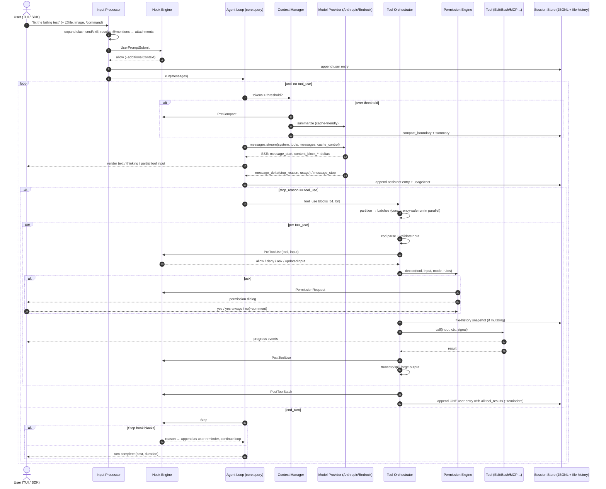
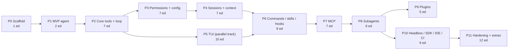

# Implementation Plan: an Open-Source Terminal Coding Agent (Claude Code parity)

Working name: **`occ`** (Open Coding Companion). Pick a final name that does not use "Claude" (trademark). Config dir `~/.occ`, project dir `.occ/`, with an opt-in **compat layer** that also reads `.claude/`, `CLAUDE.md`, `AGENTS.md`, `.mcp.json`, `SKILL.md` and agent files, so existing Claude Code setups work without changes.

---

## 0. How to read this document

### 0.1 Source / confidence legend

Every inventory row is tagged with where the information came from:

| Tag | Meaning |
|---|---|
| **T** | Observed directly: tool schemas, system-prompt behavior, and harness messages in the session that wrote this plan (Claude Code 2.1.310) |
| **H** | From `claude --help` (v2.1.310) |
| **F** | Observed in local files: `~/.claude/` layout, transcript JSONL records, plugin manifests |
| **D** | From the official docs at code.claude.com/docs (hooks, permissions, commands, skills, memory, authentication pages, fetched 2026-10-25) |
| **I** | **Inferred.** Behavior or internals not confirmed from a primary source. Treat it as a design proposal, not a spec |

### 0.2 Priority legend

| Priority | Meaning |
|---|---|
| **P0** | MVP (Phase 1–2) |
| **P1** | Needed for daily-driver parity (Phases 3–7) |
| **P2** | Full parity (Phases 8–11) |
| **P3 / OOS** | Out of scope: depends on Anthropic-hosted backends (claude.ai cloud sessions, Remote Control, Slack, Chrome extension, Artifacts, Design, cloud routines). A clone can't reproduce these without building its own backend |

### 0.3 Key API facts this plan is built on (Claude API, Oct 2026)

These constraints shape the architecture. Several of them changed in 2025–2026:

- Default model: **`claude-opus-5-5`** (1M context, 128K max output). Cheaper tiers: `claude-sonnet-5-5`, `claude-haiku-5-5`. The most capable model is `claude-fable-5-1`.
- **Thinking**: `thinking: {type: "adaptive"}` (or omit it). On Opus 5.5, `disabled` and `budget_tokens` both return a 400. Depth is controlled only by `output_config: {effort: "low"|"medium"|"high"|"xhigh"|"max"}`. The default is `medium` on Opus 5.5, so set it explicitly. `display: "summarized"` shows reasoning text; the default `"omitted"` streams empty thinking blocks.
- **Forced `tool_choice` (`any` / `tool`) returns a 400** on Opus 5.5, Sonnet 5.5 and Fable 5.1. Use `auto`, plus `strict: true` on tools.
- **No assistant prefill** (400).
- **Preserved thinking**: thinking blocks must be passed back unchanged, and editing earlier turns invalidates them. **The harness must keep history append-only.** This affects compaction, microcompaction and reminder injection (§4.4).
- **Mid-conversation `role: "system"` messages** are supported on Opus 5.5 and Sonnet 5.5. They let you add instructions without invalidating the cached prefix.
- **Prompt caching**: at most 4 breakpoints. TTL is 5 min by default, or `ttl: "1h"`. Top-level automatic `cache_control` caches the growing tail. Render order is `tools → system → messages`. The minimum cacheable prefix depends on the model (512–4096 tokens).
- **Parallel tool use**: return all `tool_result` blocks in **one** user message. Failed tools get `is_error: true`.
- **`eager_input_streaming: true`** on client tools streams large inputs (file contents) as they are generated. The client must then validate the input against the schema itself.
- `temperature` / `top_p` / `top_k` return a 400 on every model as of 2026-10-21. Don't send them.
- Other endpoints and features: `POST /v1/messages/count_tokens` for token counting. Server-side compaction is beta `compact-2026-01-12`. Context editing is beta `context-management-2025-06-27` with `clear_tool_uses_20250919`.
- SDK defaults: `maxRetries` 2 (retries 408/409/429/5xx and connection errors), 10-minute timeout. Typed errors: `Anthropic.RateLimitError`, `Anthropic.APIError`, `Anthropic.APIUserAbortError`.
- Providers: Anthropic API, **Amazon Bedrock** (`@anthropic-ai/bedrock-sdk` `AnthropicBedrockMantle`; model IDs prefixed `anthropic.`), Vertex (`@anthropic-ai/vertex-sdk`), and Foundry (`@anthropic-ai/foundry-sdk`). The machine this plan was written on uses Bedrock with `global.anthropic.*` inference-profile IDs (F), so Bedrock support is a P0 requirement, not an afterthought.

---

## Step 1 — Feature Inventory

### 1.1 Core agent loop

| Feature | What it does | User interaction | Src | Pri |
|---|---|---|---|---|
| Agentic loop | prompt → streamed model response → `tool_use` blocks → execute → `tool_result` → repeat until a response with no tool calls | Type a prompt, press Enter | T | P0 |
| Streaming output | Text, thinking, and tool inputs render as they stream in | Passive | T | P0 |
| Parallel tool calls | The model emits several `tool_use` blocks in one message; independent ones run concurrently and all results go back in one message | Passive (the system prompt encourages parallel calls) | T | P0 |
| Interrupt | Esc stops generation and running tools. The transcript stays valid because interrupted tools get synthetic error results | `Esc` | D/I | P0 |
| Message queueing | Prompts typed while the agent works are queued and delivered at the next turn boundary. Transcripts contain `queue-operation` records | Type while busy | F | P1 |
| System reminders | The harness injects `<system-reminder>` text into user turns: mode changes, todo state, file-changed notices, deferred-tool lists | Passive | T | P1 |
| Large tool output spill | Oversized tool results are written to `projects/<slug>/<session>/tool-results/<id>.txt`; the model gets a preview plus the path | Passive | T/F | P1 |
| Effort control | Sets reasoning effort per session | `--effort`, `/effort` | H | P0 |
| Fallback model | Falls back through a list of models on overload; retries the primary each new turn | `--fallback-model a,b` | H | P1 |
| Budget cap | Stops when the dollar spend limit is reached (print mode) | `--max-budget-usd` | H | P1 |
| Structured final output | Validates the final answer against a JSON Schema | `--json-schema` | H | P2 |
| Goals | Keeps working until a stated condition holds | `/goal [condition\|clear]` | D | P2 |
| Prompt suggestions | Predicts the user's next prompt after each turn | `--prompt-suggestions` | H | P2 |
| Advisor | A second, stronger model advises the executor model | `/advisor [model\|off]` | D | P2 |
| Side questions | Ask something without adding it to the main context | `/btw <q>` | D | P2 |

### 1.2 Built-in tools

| Tool | What it does | Notes / key params | Src | Pri |
|---|---|---|---|---|
| **Read** | Reads a file with `cat -n` line numbers; offset/limit; default 2000 lines; handles images, PDFs (`pages`, max 20 per request), and `.ipynb` | Absolute path; files must be Read before Edit/Write | T | P0 |
| **Write** | Creates or overwrites a file | Overwriting requires a prior Read | T | P0 |
| **Edit** | Exact string replacement; `old_string` must be unique unless `replace_all` | Fails if the file hasn't been Read; strips line-number prefixes | T | P0 |
| MultiEdit | Several edits to one file, applied atomically | Present in older versions; **may be removed in current builds (I)** | I | P2 |
| **Bash** | Runs a command in a persistent cwd. Env vars and functions don't persist, so the shell starts from a profile snapshot | `timeout` ms (max 600000), `run_in_background`, `description`; captures shell snapshots | T/F | P0 |
| PowerShell | Windows shell tool | | D | P2 |
| **Glob** | Fast file-pattern matching, sorted by mtime | Documented, but **not exposed in the auto-mode session that wrote this plan**, which pushes find/grep through Bash | D/T | P0 |
| **Grep** | ripgrep wrapper: `output_mode` content/files/count, `-A/-B/-C`, glob/type filters, multiline | Same note as Glob | D | P0 |
| NotebookEdit | Replaces, inserts, or deletes a Jupyter cell | | T | P2 |
| **WebFetch** | Fetches a URL, converts it to markdown, and answers a prompt about it with a small model; 15-minute cache; cross-host redirects returned instead of followed; offset paging | Pre-approved doc domains | T | P1 |
| WebSearch | Web search (server tool `web_search_20260209` or a provider) | | D | P1 |
| Task list (TodoWrite / TaskCreate / TaskUpdate) | Structured plan and checklist the model maintains; shown in the UI | Hooks `TaskCreated` and `TaskCompleted` exist | D | P1 |
| **Agent** | Spawns a subagent: `description`, `prompt`, `subagent_type`, `model`, `isolation: worktree\|remote`, `effort` | Runs in the background; a notification fires on completion | T | P1 |
| SendMessage / ListAgents | Continue a running or finished agent by name; list addressable agents and sessions | | T | P2 |
| TaskStop | Stops a background task or agent | | T | P1 |
| Monitor | Waits on or streams the output of a background process until a condition holds | Replaces polling | T | P1 |
| AskUserQuestion | Multiple-choice questions to the user (1–4 questions, 2–4 options, multiSelect, previews) | | T | P1 |
| EnterPlanMode / ExitPlanMode | Model-initiated plan mode; ExitPlanMode presents the plan for approval | | T | P1 |
| EnterWorktree / ExitWorktree | Moves the session into or out of a git worktree | | T | P2 |
| Skill | Loads a skill's instructions into the turn | | T | P1 |
| ToolSearch | **Deferred tool loading**: only tool names are listed up front; full schemas are fetched on demand with `select:` or keyword queries | Keeps the prompt small and cache-stable with many MCP tools | T | P1 |
| Workflow | Runs a deterministic JS orchestration script that spawns many agents (`agent()`, `parallel()`, `pipeline()`, `phase()`) | Requires explicit user opt-in | T | P2 |
| CronCreate / CronList / CronDelete, ScheduleWakeup | Recurring or self-paced in-session scheduling (`/loop`) | | T | P2 |
| ReportFindings | Typed code-review findings for UI rendering | | T | P2 |
| LSP | Language-server diagnostics and navigation (`--bare` "skips LSP") | **Internals unknown (I)** | H | P2 |
| ListMcpResources / ReadMcpResource | Access MCP resources | | D/I | P1 |
| MCP tools | `mcp__<server>__<tool>` | | D | P1 |

### 1.3 Permission system

| Feature | What it does | User interaction | Src | Pri |
|---|---|---|---|---|
| Permission prompts | Asks before risky tool calls; options are yes once / yes and don't ask again / no, with an optional comment | Interactive dialog | D | P0 |
| Tiered defaults | Reads and Grep are free inside working dirs. Bash asks, except for a built-in read-only set. Edits ask (session-level "don't ask again"). WebFetch asks, except pre-approved doc domains | | D | P0 |
| Rules | `permissions.allow`, `ask`, `deny` arrays of `Tool` or `Tool(specifier)` | settings.json, `/permissions` | D | P1 |
| Precedence | **deny → ask → allow**, first match wins, regardless of specificity or scope. A deny in any scope beats an allow in any scope | | D | P1 |
| Bash rules | `*` wildcard over the whole command. A trailing ` *` also matches no arguments (`Bash(ls *)` matches `ls`). Compound commands are split on `&& \|\| ; \| \|& &` and newlines: allow rules must match **every** subcommand; deny/ask rules match **any** subcommand, including inside `$(…)`, subshells, and loops. Wrappers stripped before matching: `timeout time nice nohup stdbuf command builtin noglob` and bare `xargs`. Exec wrappers (`watch setsid ionice flock`) and `find -exec/-delete` can't be approved by a prefix rule. A dangling `&&` makes the command unparseable, so no allow rule applies. "Don't ask again" on a compound saves one rule per subcommand (max 5). A startup warning fires when `*` comes before the subcommand. `Bash(command:…)` input-field rules are ignored with a warning | | D | P1 |
| Read-only commands | A built-in set runs without prompting; `cd` within working dirs counts as read-only. Redirections and variable expansion (`URL=… && curl $URL`) still prompt | | D | P1 |
| Path rules | `Read(...)` / `Edit(...)` use gitignore-style patterns. Anchors: `//abs`, `~/home`, `/` = relative to the **settings file's root**, `./` or bare = cwd. `!` negation in deny/ask lists. A deny matches if the request path **or** its symlink target matches. `Write`, `NotebookEdit`, and `Glob` path rules never match (use `Edit` / `Read`) | | D | P1 |
| WebFetch rules | `WebFetch(domain:example.com)` | | D | P1 |
| MCP rules | `mcp__server`, `mcp__server__tool`, wildcards | | D | P1 |
| Agent rules | `Agent(name)` | | D | P2 |
| Cd rules | `Cd(path)`: whole-path anchored; `*` matches one segment, `**` many | | D | P2 |
| Tool-name wildcards | e.g. `mcp__*` | | D | P1 |
| Permission modes | `default` (alias `manual`), `acceptEdits`, `plan`, `auto`, `dontAsk`, `bypassPermissions` | `--permission-mode`, `defaultMode`, Shift+Tab cycles | H/D | P0–P2 |
| acceptEdits | Auto-accepts edits plus `mkdir touch mv cp` inside working dirs | | D | P1 |
| auto mode | A background **classifier** model reviews shell and network actions against the user's intent; denials fire the `PermissionDenied` hook; configured via `autoMode.environment` and `claude auto-mode` | | H/D | P2 |
| dontAsk | Anything that would prompt is denied | | D | P1 |
| bypassPermissions | No prompts, including protected paths; `--dangerously-skip-permissions`; can be disabled by policy (`disableBypassPermissionsMode`) | | H/D | P1 |
| Protected paths | Writes to `.git`, `.claude`, and similar always prompt outside bypass | | D | P1 |
| Working directories | cwd plus `--add-dir` / `/add-dir` / `additionalDirectories`. These grant file access, **not** config loading | | H/D | P1 |
| CLI overrides | `--allowedTools`, `--disallowedTools`, `--tools` (sets the available tool set) | | H | P0 |
| Headless prompts | `--permission-prompt-tool` (an MCP tool answers), or `--permission-prompts none` | | H | P1 |
| Workspace trust | Trust dialog on first use of a folder; project allow rules and hooks don't run before trust. `-p` skips the dialog | | H/D | P1 |
| Restricted / safe / bare modes | `--restricted` removes code-running tools and ignores user/project settings; `--safe-mode` disables all customizations; `--bare` skips hooks, LSP, plugins, and auto-memory | | H | P2 |
| Sandboxing | OS-level filesystem and network isolation for Bash (`/sandbox`). **Mechanism inferred: bubblewrap + seccomp on Linux, Seatbelt `sandbox-exec` on macOS, network via a filtering proxy** | `/sandbox` | D/I | P2 |
| Hooks vs rules | PreToolUse exit code 2 blocks before rules are checked. A hook's `allow` **cannot** override deny or ask rules | | D | P1 |

### 1.4 Context and memory management

| Feature | What it does | User interaction | Src | Pri |
|---|---|---|---|---|
| CLAUDE.md hierarchy | Managed (org) → user `~/.claude/CLAUDE.md` → project `./CLAUDE.md` or `./.claude/CLAUDE.md` → `CLAUDE.local.md` (gitignored); loaded from cwd **and every parent directory** at startup; subdirectory files load lazily when Claude reads files there | Edit files, `/memory` | D | P0/P1 |
| AGENTS.md | Read instead of CLAUDE.md when no CLAUDE.md / CLAUDE.local.md exists in cwd or above | | D | P1 |
| `@imports` | `@path` inside memory files; relative to the importing file; max depth **4 hops**; skipped inside code spans and fences; external imports need one-time approval | | D | P1 |
| Rules dir | `.claude/rules/*.md` and `~/.claude/rules/`; `paths:` frontmatter limits loading to matching files | | D | P1 |
| `claudeMdExcludes` | Glob-exclude specific memory files | | D | P2 |
| Auto memory | The agent writes notes to `~/.claude/projects/<slug>/memory/*.md` with a `MEMORY.md` index; the first 200 lines / 25KB load every session; frontmatter `name`, `description`, `metadata.type` (user / feedback / project / reference); `[[links]]` | `/memory` to toggle or view | T/F/D | P2 |
| `/init` | Generates CLAUDE.md by analyzing the repo | `/init` | D | P1 |
| `/compact [instructions]` | Summarizes the conversation to free context | | D | P1 |
| Auto-compaction | Triggers near the context limit; window configurable | `--autocompact auto\|100k–1M`, `/autocompact` | H/D | P1 |
| `/clear [name]` | Starts a fresh context; the old session stays resumable | | D | P0 |
| `/context` | Colored grid of context usage by category, with suggestions | | D | P2 |
| Prompt caching | Automatic, cache-stable request layout | Passive | T/F (transcript usage shows cache reads) | P1 |
| System-prompt snapshot | Records the system prompt once per conversation and reuses it verbatim until compaction (cache stability) | `--system-prompt-snapshot` | H | P2 |
| Dynamic sections | `--exclude-dynamic-system-prompt-sections` moves cwd, env, git status, and memory paths into the first user message for cross-user cache reuse | | H | P2 |
| Skill content lifecycle | Invoked skill bodies persist; after compaction the 5 most recent are kept within 25K tokens | | D | P1 |
| `/recap`, `/export`, `/copy` | Session summary; export as text; copy the Nth reply | | D | P2 |

### 1.5 Slash commands (built-in)

There are about 100 built-in commands in v2.1.310 (D). Grouped by area, with a priority for each group:

| Group | Commands | Pri |
|---|---|---|
| Session and context | `/clear` `/compact` `/context` `/resume` `/rename` `/branch` `/fork` `/rewind` `/export` `/copy` `/recap` `/btw` `/exit` `/diff` `/focus` | P0–P1 |
| Model and effort | `/model` `/effort` `/fast` `/advisor` `/autocompact` `/output-style` | P1 |
| Config | `/config` `/permissions` `/hooks` `/memory` `/keybindings` `/theme` `/color` `/statusline` `/terminal-setup` `/tui` `/scroll-speed` `/sandbox` `/add-dir` `/cd` `/vim` (removed; now under `/config` → Editor mode) | P1 |
| Extensibility | `/skills` `/reload-skills` `/plugin` `/reload-plugins` `/agents` `/mcp` `/ide` `/list-agents` `/tasks` (alias `/bashes`) `/workflows` `/subtask` `/background` `/stop` | P1–P2 |
| Auth and account | `/login` `/logout` `/status` `/usage` (`/cost`, `/stats`) `/upgrade` `/privacy-settings` `/rate-limit-options` `/usage-credits` `/setup-bedrock` `/setup-vertex` | P1 |
| Diagnostics | `/doctor` `/debug` `/bug` `/feedback` `/release-notes` `/heapdump` `/insights` | P1–P2 |
| Project | `/init` `/plan` `/security-review` `/code-review` (`/review`) `/simplify` `/install-github-app` `/import` `/team-onboarding` | P1–P2 |
| Bundled skills | `/run` `/verify` `/run-skill-generator` `/batch` `/loop` `/claude-api` `/dataviz` `/update-config` `/fewer-permission-prompts` `/skill-doctor` `/workflow-authoring` `/plugin-authoring` `/deep-research` | P2 |
| Hosted (OOS) | `/remote-control` `/remote-env` `/teleport` `/desktop` `/mobile` `/chrome` `/claude-in-chrome` `/schedule` `/autofix-pr` `/ultrareview` `/artifacts` `/design*` `/slides` `/install-slack-app` `/web-setup` `/voice` `/passes` `/radio` `/stickers` `/powerup` | P3 |

Command semantics (D):
- A command is recognized only at the start of a message; the rest of the message becomes its arguments.
- Up to 6 skills can be chained (`/a /b text`).
- Commands sent mid-turn are queued, except `/status`, `/tasks`, and `/usage`, which run immediately.
- The menu does fuzzy matching.

### 1.6 Custom commands and skills

| Feature | What it does | User interaction | Src | Pri |
|---|---|---|---|---|
| Skill locations | `~/.claude/skills/<n>/SKILL.md`, `.claude/skills/<n>/SKILL.md`, nested `<subdir>/.claude/skills`, plugin skills; legacy `.claude/commands/<n>.md` | Files | D/F | P1 |
| Frontmatter | `name description when_to_use argument-hint arguments disable-model-invocation user-invocable allowed-tools disallowed-tools model effort context:fork agent background paths shell hooks metadata license compatibility` | | D | P1 |
| Arguments | `$ARGUMENTS`, `$ARGUMENTS[0]`, `$0 $1…`, named `$name`; `\$` escapes | `/cmd a b` | D | P1 |
| Shell injection | `` !`cmd` `` inline and ` ```! ` fenced blocks run before Claude sees the text; 2-minute timeout; failure aborts the skill; exit 1 from grep/diff/find is treated as normal; disabled by `disableSkillShellExecution` | | D | P1 |
| File refs | `@file` inside a skill, relative to the skill directory | | D | P1 |
| Env substitution | `${CLAUDE_SESSION_ID} ${CLAUDE_EFFORT} ${CLAUDE_SKILL_DIR} ${CLAUDE_PROJECT_DIR} ${CLAUDE_PLUGIN_ROOT} ${CLAUDE_PLUGIN_DATA}` | | D | P1 |
| Model invocation | Skill descriptions are listed in context and the model calls the `Skill` tool. `disable-model-invocation` hides a skill from the model; `user-invocable:false` hides it from the `/` menu | | T/D | P1 |
| `allowed-tools` grant | Pre-approves tools for **one turn** | | D | P1 |
| Forked skills | `context: fork` runs the skill as a subagent | | D | P2 |
| `skillOverrides` | Per-skill `on` / `name-only` / `user-invocable-only` / `off` | settings | D | P2 |
| Live reload | Skills are watched; `/reload-skills` | | D | P1 |
| `UserPromptExpansion` hook | Fires when a slash command expands | | D | P2 |

### 1.7 Subagents, background agents, teams, workflows

| Feature | What it does | User interaction | Src | Pri |
|---|---|---|---|---|
| Built-in agent types | `general-purpose` (all tools), `Explore` (read-only search), `Plan` (architect, read-only), `statusline-setup`, `claude-code-guide`, `fork` (inherits the full parent context) | Model calls `Agent` | T | P1 |
| Custom agents | `.claude/agents/*.md` and `~/.claude/agents/*.md` with frontmatter (`name`, `description`, `tools`, `model`, …); `--agents '{json}'`; `--agent <name>` makes an agent the main session | Files / CLI | H/T | P1 |
| Isolated context | Each subagent has its own message history; only its final report returns to the parent | | T | P1 |
| Sidechain transcripts | `projects/<slug>/<session>/subagents/agent-<id>.jsonl` plus `.meta.json` (`agentType`, `description`, `toolUseId`, **`spawnDepth`**, `requestShape: background`, `finished`); records carry `isSidechain` | | F | P1 |
| Background execution | Subagents run in the background; the parent gets a `<task-notification>` on completion and must not poll | | T | P1 |
| Continue an agent | `SendMessage({to, message})` resumes with the agent's context intact | | T | P2 |
| Worktree isolation | `isolation: "worktree"` gives the agent its own git worktree, auto-cleaned if unchanged | | T | P2 |
| Background sessions | `claude --bg`, `claude agents`, `attach`, `logs`, `stop`, `rm`, `respawn`; `/background`, `/fork` | CLI | H/D | P2 |
| Agent teams | Teammates with idle detection (`TeammateIdle` hook), a shared task list, and cross-session messaging | | D | P2 |
| Workflows | Deterministic orchestration scripts (`export const meta`), resumable by run ID, `/workflows` progress view | | T | P2 |
| Hooks | `SubagentStart`, `SubagentStop` (can block completion) | | D | P1 |

### 1.8 Plugins and marketplaces

| Feature | What it does | User interaction | Src | Pri |
|---|---|---|---|---|
| Plugin package | Directory with `.claude-plugin/plugin.json` (`name`, `version`, `description`, `author`, `homepage`, `repository`, `license`) bundling `skills/`, `agents/`, `commands/`, `hooks/hooks.json`, MCP servers, output styles | | F/D | P2 |
| Marketplaces | `.claude-plugin/marketplace.json`; sources such as `{source: "github", repo}`; `extraKnownMarketplaces` setting | `/plugin`, `claude plugin …` | F | P2 |
| Install state | `~/.claude/plugins/installed_plugins.json` (v2: scope, installPath, version, gitCommitSha), `cache/<mkt>/<plugin>/<ver>/`, `known_marketplaces.json` | | F | P2 |
| Enablement | `enabledPlugins: {"name@marketplace": true}` | settings | F | P2 |
| Session-only plugins | `--plugin-dir`, `--plugin-url` (zip) | CLI | H | P2 |
| Namespacing | Plugin MCP tools are named `mcp__plugin_<plugin>_<server>__<tool>` | | D | P2 |
| Mods | UI extensions (panels, status bands, toasts, `tool.check` event that approves or refuses calls) | | D/T | P3 |

### 1.9 Hooks

Config shape: `hooks.<Event>[] = {matcher, hooks:[{type, command|url|prompt, args?, if?, timeout?, statusMessage?, async?, asyncRewake?, shell?, onFailure?}]}`, plus `disableAllHooks`. Sources: user, project, local, and managed settings, plugin `hooks/hooks.json`, and skill or agent frontmatter. (D)

| Event | Matcher on | Can block? (exit 2 / decision) | Notable output fields | Pri |
|---|---|---|---|---|
| SessionStart | `startup\|resume\|clear\|compact\|fork` | no | `additionalContext`, `initialUserMessage`, `watchPaths`, `sessionTitle` | P1 |
| Setup | `init\|maintenance` | no | | P2 |
| UserPromptSubmit | — | yes | `decision:block`, `additionalContext` | P1 |
| UserPromptExpansion | command name | yes | | P2 |
| **PreToolUse** | tool name | yes | `permissionDecision: allow\|deny\|ask\|defer`, `updatedInput`, `additionalContext` | P1 |
| PermissionRequest | tool name | — | `decision.behavior allow\|deny`, `updatedInput` | P1 |
| PermissionDenied | tool name | — | `retry` | P2 |
| **PostToolUse** | tool name | yes (feedback) | `updatedToolOutput`, `additionalContext` | P1 |
| PostToolUseFailure | tool name | yes (feedback) | | P1 |
| PostToolBatch | — | blocks the next model call | | P2 |
| Notification | `permission_prompt\|idle_prompt\|…` | no | `terminalSequence` | P1 |
| MessageDisplay | — | no | `displayContent` (display only; 10s timeout) | P2 |
| SubagentStart / SubagentStop | agent type | Stop: yes | | P1 |
| TaskCreated / TaskCompleted | — | yes | | P2 |
| **Stop** | — | yes (forces it to keep going) | `decision:block` + reason | P1 |
| StopFailure | error type | no | | P2 |
| TeammateIdle | — | yes | | P2 |
| InstructionsLoaded | load reason | no | | P2 |
| ConfigChange | config source | yes | | P2 |
| CwdChanged, DirectoryAdded, FileChanged | various | no | | P2 |
| WorktreeCreate / WorktreeRemove | — | replaces the git behavior | stdout = path | P2 |
| PreCompact / PostCompact | `manual\|auto` | Pre: yes | | P1 |
| PreModelSwitch / PostModelSwitch | model | Pre: yes | | P2 |
| Elicitation / ElicitationResult | MCP server | yes | `action`, `content` | P2 |
| SessionEnd | end reason | no | 1.5s total budget | P1 |

Common stdin fields: `session_id, prompt_id, transcript_path, cwd, scratchpad_dir, permission_mode, effort, hook_event_name, agent_id, agent_type`. Exit codes: **0** = success, and stdout JSON is parsed if present. **2** = block on events that support it, and stderr becomes the reason. **Other** = non-blocking error, unless `onFailure: "block"` is set. Universal JSON fields: `continue`, `stopReason`, `systemMessage`, `suppressOutput`, `additionalContext`, `terminalSequence`.

Hook types and default timeouts:

| Type | Default timeout |
|---|---|
| `command` | 600s (30s on UserPromptSubmit and the model-switch events; 10s on MessageDisplay) |
| `http` | Same as `command` |
| `mcp_tool` | Same as `command` |
| `prompt` (LLM judge) | 30s |
| `agent` | 60s (experimental) |

Matcher rules: `*`, empty, or omitted matches everything. A matcher made only of letters, digits, `_ - , |` and spaces is an exact match or `|`-separated list. Anything else is an **unanchored JS regex**. (D)

### 1.10 MCP client

| Feature | What it does | User interaction | Src | Pri |
|---|---|---|---|---|
| Transports | stdio, SSE (legacy), Streamable HTTP | `claude mcp add` | D | P1 |
| Scopes | local (per-project, private), project (`.mcp.json`, committed, needs approval), user | `--scope` | D/I | P1 |
| CLI | `claude mcp add/list/get/remove`, `/mcp [reconnect <server>\|all]`, `--mcp-config`, `--strict-mcp-config` | | H/D | P1 |
| OAuth | OAuth 2.1 + PKCE, metadata discovery, dynamic client registration, token refresh; `/mcp` triggers auth | | D/I | P1 |
| Tools | Exposed as `mcp__server__tool`; deferred via ToolSearch when there are many | | T/D | P1 |
| Resources | `@server:uri` mentions; list and read tools | | D/I | P2 |
| Prompts | Exposed as slash commands, `/mcp__server__prompt` (**I**) | | I | P2 |
| Elicitation | The server asks the user for structured input | Form dialog | D | P2 |
| list_changed | Dynamic tool refresh | | I | P2 |
| Org controls | Per-connector `ask`, `requiresUserInteraction` | | D | P2 |
| claude.ai connectors | Remote connectors from the account | | D | P3 |
| Serve mode | `claude mcp serve` exposes the built-in tools as an MCP server (**I**: present in older versions) | | I | P2 |

### 1.11 Modes

| Mode | Behavior | Entry | Src | Pri |
|---|---|---|---|---|
| Plan | Read-only exploration; the plan is written to `~/.claude/plans/<slug>.md`; ExitPlanMode asks the user to approve, then the session switches to an editing mode | Shift+Tab, `/plan [desc]`, EnterPlanMode tool, `--permission-mode plan` | T/F/D | P1 |
| Accept edits | Auto-approves file edits | Shift+Tab | D | P1 |
| Auto | Classifier-gated autonomy | Shift+Tab / flag | D | P2 |
| Focus / fullscreen | UI modes | `/focus`, `/tui fullscreen` | D | P2 |

### 1.12 Sessions, checkpoints, rewind

| Feature | What it does | User interaction | Src | Pri |
|---|---|---|---|---|
| Transcript store | `~/.claude/projects/<cwd with / → ->/<uuid>.jsonl` (see §2.6) | | F | P0 |
| Continue / resume | `-c` most recent in cwd; `-r [id\|name\|search]` picker; `/resume` | CLI / command | H | P1 |
| Fork on resume | `--fork-session`; `/branch` (conversation branch); `/fork` (background copy) | | H/D | P2 |
| Naming | `-n/--name`, `/rename`; AI-generated titles (`ai-title` records) | | H/F | P1 |
| Explicit ID | `--session-id <uuid>` | | H | P1 |
| No persistence | `--no-session-persistence` (print mode) | | H | P1 |
| File checkpoints | Before each edit, the original is snapshotted to `~/.claude/file-history/<session>/<pathhash>@v<N>` | Passive | F | P1 |
| Rewind | Restores conversation and/or code to a prior user message, or summarizes from there | `/rewind`, `Esc Esc` | D | P1 |
| Prompt history | `~/.claude/history.jsonl`; Up arrow and Ctrl+R search | | F | P1 |
| Paste cache | Large pastes and images stored in `paste-cache/` and referenced as `[Pasted text #1]` | | F/I | P1 |
| Cost state | `cost-state` records per session; `stats-cache.json` | | F | P1 |
| PR-linked sessions | `--from-pr <n\|url>` | | H | P2 |
| Purge | `claude purge [path]` deletes all state for a project | | H | P2 |
| Cleanup | Old transcripts removed after `cleanupPeriodDays` (I); `.last-cleanup` marker | | F/I | P2 |

### 1.13 Git integration

| Feature | What it does | User interaction | Src | Pri |
|---|---|---|---|---|
| Git context | Branch, status, and recent commits in the system prompt (dynamic section); `gitBranch` stored on each transcript record | | H/F | P0 |
| Commit / PR workflow | System-prompt guidance: commit only when asked, branch first if on the default branch, use `gh` for PRs, append attribution trailers (`Co-Authored-By:` / "Generated with"), never use interactive flags | Natural language | T | P1 |
| `@name` hygiene | Don't write bare `@handles` in PRs/issues except real logins | | T | P1 |
| Worktrees | `-w [name]`, `--tmux`, EnterWorktree, agent isolation; `WorktreeCreate` hook overrides | | H/T | P2 |
| `/diff` | Reviews working-tree changes, including Claude's edits | | D | P1 |
| Reviews | `/code-review`, `/security-review`, `/simplify` | | D/T | P2 |
| GitHub App | `/install-github-app` | | D | P2 |

### 1.14 IDE integrations, headless, and SDK

| Feature | What it does | User interaction | Src | Pri |
|---|---|---|---|---|
| Print mode | `-p "prompt"` runs non-interactively and exits; reads stdin | CLI | H | P0 |
| Output formats | `--output-format text\|json\|stream-json`; `--include-partial-messages`; `--include-hook-events`; `--forward-subagent-text` | | H | P1 |
| Streaming input | `--input-format stream-json`; `--replay-user-messages` | | H | P1 |
| System prompt flags | `--system-prompt`, `--append-system-prompt` (+ `-file` variants) | | H | P1 |
| Agent SDK | Library form (`query(prompt, options)`) with hooks, `canUseTool`, MCP, subagents, sessions | Code | D | P2 |
| VS Code / JetBrains | Extension connects to the CLI: shows diffs in the IDE, shares selection and open file, diagnostics; `--ide`, `/ide`. **Transport inferred: local WebSocket/MCP server advertised through a lock file in `~/.claude/ide/`** | IDE | H/D/I | P2 |
| Desktop / web / cloud | `--desktop`, `--cloud`, `--teleport`, `--remote-control` | | H | P3 |

### 1.15 Terminal UI

| Feature | What it does | User interaction | Src | Pri |
|---|---|---|---|---|
| Markdown rendering | Streaming markdown, syntax-highlighted code, tables | | T | P0 (plain) / P1 |
| Diff display | Colored structured patches for Edit/Write, with word-level highlights | | D | P1 |
| Tool-call rows | Compact one-line summary per call, expandable; `Ctrl+O` verbose transcript | | D/I | P1 |
| Spinner / status | Elapsed time, token counts, Esc to interrupt | | I | P1 |
| Permission dialogs | Shows the command or diff with options | | D | P0 |
| Prompt input | Multiline (Shift+Enter, `\`+Enter, `/terminal-setup`), history, paste handling | | D | P0/P1 |
| `@` mentions | Fuzzy file/dir autocomplete; attaches file content; `@server:uri` for MCP | Type `@` | D | P1 |
| `!` bash mode | Runs a shell command directly; output goes into context | `! cmd` | T | P1 |
| `#` quick memory | Appends a line to memory (**I**: in older versions; may now route through `/memory`) | `# note` | I | P2 |
| Slash menu | Fuzzy-filtered command list with argument hints | `/` | D | P0 |
| Image paste | Ctrl+V or drag-drop image → image content block | | D/F | P1 |
| Keybindings | `~/.claude/keybindings.json`, chords, `/keybindings` | | T | P2 |
| Vim mode | Editor mode in `/config` | | D | P2 |
| Themes | `/theme` (auto / light / dark / colorblind) | | F/D | P1 |
| Status line | User command whose stdout renders as the status bar (gets session JSON on stdin) | `/statusline` | D | P2 |
| Output styles | System-prompt overlays (e.g. explanatory, concise) | `/output-style` | D | P2 |
| Notifications | Terminal bell or OSC sequences when idle or waiting | | D | P1 |
| Accessibility | `--ax-screen-reader` flat output | | H | P2 |
| Fullscreen | Alternate-screen renderer with mouse scrolling | `/tui fullscreen` | D | P2 |

### 1.16 Configuration hierarchy

| Feature | What it does | Src | Pri |
|---|---|---|---|
| Precedence (high → low) | **Managed policy** (can't be overridden) → CLI args → `.claude/settings.local.json` → `.claude/settings.json` → `~/.claude/settings.json` | D | P1 |
| Merging | Scalars: the higher scope wins. Permission arrays: concatenated across scopes, then deny → ask → allow evaluation | D | P1 |
| Managed delivery | File (**I**: `/etc/claude-code/managed-settings.json` on Linux, `/Library/Application Support/ClaudeCode/` on macOS), MDM, server-managed; the managed tier doesn't merge across sources | D/I | P2 |
| Global state | `~/.claude.json` (**I**): onboarding, per-project trust, MCP local/user scopes | I | P1 |
| Keys seen locally | `env`, `model`, `enabledPlugins`, `extraKnownMarketplaces`, `askUserQuestionTimeout`, `theme` | F | P1 |
| Other key keys | `permissions{allow,ask,deny,defaultMode,additionalDirectories,disableBypassPermissionsMode,disableAutoMode}`, `hooks`, `disableAllHooks`, `apiKeyHelper`, `statusLine`, `outputStyle`, `skillOverrides`, `disableSkillShellExecution`, `claudeMdExcludes`, `forceLoginMethod`, `forceLoginOrgUUID`, `allowedProviders`, `autoMode` | D | P1/P2 |
| CLI | `--settings <file\|json>`, `--setting-sources user,project,local`, `/config key=value` | H/D | P1 |
| Multi-account | `CLAUDE_CONFIG_DIR` | D | P1 |
| Live reload | Settings files are watched; `ConfigChange` hook | D | P2 |

### 1.17 Model, thinking, cost

| Feature | What it does | Src | Pri |
|---|---|---|---|
| Model selection | Aliases (`fable`, `opus`, `sonnet`, `haiku`) or full IDs; `--model`, `/model` (saved as the default); `ANTHROPIC_DEFAULT_{OPUS,SONNET,HAIKU}_MODEL` overrides (F); `[1m]` suffix selects the 1M-context variant (F) | H/F | P0 |
| Effort | `low…max` per session, plus per-skill and per-agent overrides | H/D | P0 |
| Thinking display | Summarized reasoning shown dimmed; collapsible | I | P1 |
| Fast mode | `/fast` (premium faster output on supported Opus) | D | P2 |
| Usage / cost | `/usage` (session cost, plan limits, stats); per-model token accounting including cache read/write, thinking tokens, and web search counts (transcript `usage` objects) | D/F | P1 |
| Small-model tasks | Titles, WebFetch summarization, classifiers, and compaction helpers use Haiku (**I**) | I | P1 |

### 1.18 Auth, telemetry, errors

| Feature | What it does | Src | Pri |
|---|---|---|---|
| Credential precedence | 1. Cloud provider (`CLAUDE_CODE_USE_BEDROCK` / `VERTEX` / `FOUNDRY`) → 2. `ANTHROPIC_AUTH_TOKEN` (Bearer) → 3. `ANTHROPIC_API_KEY` (x-api-key; interactive approval once) → 4. `apiKeyHelper` → 5. `CLAUDE_CODE_OAUTH_TOKEN` → 6. Anthropic profiles / WIF → 7. `/login` subscription OAuth | D | P0 (env key + Bedrock) / P1 |
| Storage | macOS Keychain; Linux `~/.claude/.credentials.json` with mode 0600 | D | P1 |
| `apiKeyHelper` | Script returns a key; slow-helper notice after 10s; fails after 3 attempts | D | P1 |
| `setup-token` | 1-year OAuth token for CI | D/H | P3 (needs Anthropic OAuth) |
| Base URL / gateway | `ANTHROPIC_BASE_URL`; LLM gateways | D | P1 |
| Retries | Exponential backoff on 429 / 529 / 5xx / network errors, with countdown UI; fallback model on overload | H/I | P0 |
| Rate limits | `/rate-limit-options`; wait-and-continue | D | P2 |
| Debug logging | `-d [filter]` categories (`hooks,mcp,…`, `!`negation), `--debug-file` | H | P1 |
| Doctor | `claude doctor`, `/doctor` | H/D | P2 |
| Telemetry | Opt-in OpenTelemetry metrics/logs (**I**: `CLAUDE_CODE_ENABLE_TELEMETRY`, OTLP env vars); `/bug` reports with consent | D/I | P2 |
| Updates | Auto-update (`.last-update-result.json`), `claude update`, `claude install` | F/H | P2 |

### 1.19 CI / GitHub Actions

| Feature | What it does | Src | Pri |
|---|---|---|---|
| GitHub Action | Runs the agent on `@claude` mentions in issues/PRs, or on events; uses `-p` / SDK with a restricted tool set (**I**: `anthropics/claude-code-action`) | D/I | P2 |
| App install | `/install-github-app` sets up the App and workflow file | D | P2 |
| Headless guarantees | Deterministic exit codes, JSON result (cost, turns, session_id, `is_error`), `--max-budget-usd`, `--permission-prompts none` | H | P1 |

### 1.20 Additional features found during research

- **Shell snapshots** (`~/.claude/shell-snapshots/snapshot-bash-*.sh`, F): the user's aliases, functions, and PATH are captured once, then sourced before each Bash call, so commands behave like the user's shell. **P1.**
- **Session env** (`session-env/<session>/`, F): per-session environment persistence. **Details I.**
- **Scratchpad dir** (hook input `scratchpad_dir`, D): a per-session temp directory.
- **Downloaded-file hygiene** (T): untrusted downloads go into their own directory; Python runs with `-I`.
- **Import from other agents** (`claude import [codex|gemini]`, H).
- **Untrusted-content framing** (T): tool results and recalled memories are framed as data, not instructions.

---

## Step 2 — Architecture

### 2.1 Language / runtime choice

| Criterion | TypeScript (Bun / Node) | Python | Rust | Go |
|---|---|---|---|---|
| Anthropic SDK | Official, first-class (streaming helpers, typed errors, Bedrock/Vertex/Foundry packages) | Official, first-class | Community only | Official |
| MCP SDK | **Reference implementation** (`@modelcontextprotocol/sdk`): every transport plus OAuth helpers | Official, mature | Official `rmcp`, younger | Official, younger |
| TUI | **Ink** (React for CLIs; what Claude Code uses, I) | Textual (rich, but heavier) | ratatui (excellent, immediate-mode) | Bubble Tea (excellent) |
| Startup time | Bun ~40ms, Node ~80–150ms | 200–500ms | <10ms | <10ms |
| Single binary | `bun build --compile` | PyInstaller (fragile) | native | native |
| Shell parsing | `web-tree-sitter` + tree-sitter-bash wasm | tree-sitter bindings | tree-sitter native | tree-sitter cgo |
| Plugin/hook ecosystem fit | JSON, JS workflow scripts, npm-distributed MCP servers | good | weaker (needs embedded JS for Workflow scripts) | weaker |
| Contributor pool | Largest | Large | Smaller | Medium |
| Parity reference | Claude Code is a JS/TS app (`/heapdump` writes "a JavaScript heap snapshot", D) | — | — | — |

**Decision: TypeScript, strict mode, on Bun (dev + compiled binary), keeping Node 22 compatible** so the SDK package also runs under Node in IDE extensions and CI.

Reasons:
1. MCP and Anthropic SDKs are both reference-quality in TS.
2. Ink gives React-style composition for a complex streaming UI.
3. The Workflow feature executes JS scripts natively.
4. One language covers CLI, SDK, VS Code extension, and GitHub Action.

Mitigations for TS weaknesses:
- Startup: lazy-import heavy modules (MCP, tree-sitter, highlighters).
- Memory: cap transcript size kept in memory; stream JSONL.
- CPU-heavy work: delegate to `ripgrep` and `git` subprocesses.

### 2.2 Repository layout

```
occ/
├─ package.json            # bun workspaces
├─ tsconfig.base.json      # strict, noUncheckedIndexedAccess, exactOptionalPropertyTypes
├─ packages/
│  ├─ core/                # agent loop, messages, model client, context manager — NO UI, NO fs policy
│  │  └─ src/{query.ts, stream.ts, request.ts, retry.ts, messages/, context/, compaction/, cost.ts, events.ts}
│  ├─ providers/           # Anthropic / Bedrock / Vertex / Foundry client factories, model registry, aliases
│  ├─ tools/               # built-in tools, one dir each: read/ write/ edit/ bash/ glob/ grep/ webfetch/ websearch/ todo/ notebook/ ask/ plan/ agent/ skill/ toolsearch/ monitor/ cron/
│  │  └─ src/{registry.ts, tool.ts, file-state.ts, truncation.ts}
│  ├─ permissions/         # rule parser, matchers (bash, path, domain, mcp), engine, modes, classifier (auto mode)
│  │  └─ src/bash/{parse.ts, split.ts, wrappers.ts, readonly.ts}
│  ├─ shell/               # persistent-cwd shell runner, shell snapshot, background process manager, sandbox adapters
│  ├─ config/              # settings schema (zod), loaders per scope, merge, watch, managed policy, env expansion
│  ├─ memory/              # CLAUDE.md/AGENTS.md discovery, @import resolver, rules/, auto-memory
│  ├─ session/             # JSONL transcript store, resume/fork, file-history checkpoints, rewind, history.jsonl
│  ├─ hooks/               # hook config, matcher, executors (command/http/prompt/agent/mcp_tool), aggregation
│  ├─ mcp/                 # MCP manager, transports, OAuth provider, tool/resource/prompt adapters
│  ├─ extensions/          # skills, slash commands, custom agents, output styles, plugins/marketplaces
│  ├─ agents/              # subagent runner, background task manager, worktree isolation, SendMessage, workflows
│  ├─ tui/                 # Ink app: transcript view, prompt input, dialogs, diff renderer, keybindings, vim
│  ├─ cli/                 # commander entry, flags → SessionOptions, print/stream-json modes, subcommands (mcp, plugin, agents…)
│  ├─ sdk/                 # public library API: query(), types, canUseTool, hooks callbacks
│  ├─ ide/                 # IDE bridge server + VS Code extension (later: JetBrains)
│  └─ github-action/       # action.yml + runner
├─ evals/                  # task suites, harness, graders (see §5.2)
└─ docs/
```

Dependency rule, enforced by `dependency-cruiser` in CI:

```
cli → tui → (agents, extensions, mcp, hooks, session, memory, config, permissions, tools, shell) → core → providers
```

`core` must never import from `tui` or `cli`. That rule keeps the SDK/headless path UI-free.

### 2.3 Core abstractions (type signatures)

```ts
// ---------- packages/core/src/messages/types.ts ----------
import type Anthropic from "@anthropic-ai/sdk";

/** One line in the JSONL transcript. Mirrors observed Claude Code records. */
export type TranscriptEntry =
  | UserEntry | AssistantEntry | SystemEntry | AttachmentEntry
  | CompactBoundaryEntry | QueueOpEntry | TitleEntry | CostStateEntry;

interface EntryBase {
  uuid: string;
  parentUuid: string | null;       // linked list; branches/rewind = new child of an older node
  sessionId: string;
  timestamp: string;               // ISO
  cwd: string;
  gitBranch?: string;
  isSidechain: boolean;            // true inside subagent transcripts
  agentId?: string;
  version: string;
  permissionMode: PermissionMode;
}
export interface UserEntry extends EntryBase {
  type: "user";
  message: Anthropic.MessageParam & { role: "user" };
  origin: "prompt" | "tool_result" | "hook" | "reminder" | "notification" | "command";
  promptId?: string;               // groups everything produced by one user prompt
  toolUseResult?: unknown;         // rich (UI-side) result, not sent to API
}
export interface AssistantEntry extends EntryBase {
  type: "assistant";
  message: Anthropic.Message;      // stored per content block in CC (F); we store whole message + requestId
  requestId?: string;
  costUSD?: number;
}
export interface CompactBoundaryEntry extends EntryBase {
  type: "system"; subtype: "compact_boundary";
  trigger: "manual" | "auto"; preTokens: number; logicalParentUuid: string;
}

// ---------- packages/tools/src/tool.ts ----------
import { z } from "zod";

export interface ToolContext {
  sessionId: string;
  agentId?: string;
  cwd: () => string;
  workingDirs: () => readonly string[];
  signal: AbortSignal;
  fileState: FileStateCache;               // read-before-edit + staleness
  permissionMode: () => PermissionMode;
  emit: (e: ToolProgressEvent) => void;     // UI progress
  hooks: HookEngine;
  settings: () => EffectiveSettings;
  spawnAgent: (req: AgentRequest) => Promise<AgentHandle>;  // for Agent tool
  askUser: (q: UserQuestion) => Promise<UserAnswer>;        // for AskUserQuestion
}

export type ValidationResult = { ok: true } | { ok: false; message: string; errorCode?: string };

export interface ToolResult<O> {
  data: O;                                  // structured, for UI/SDK
  /** extra user-visible content appended to the turn (e.g. images, reminders) */
  attachments?: Anthropic.ContentBlockParam[];
  newMessages?: TranscriptEntry[];          // e.g. Skill tool injects skill body
  contextModifier?: (c: ToolContext) => ToolContext; // e.g. cd, mode switch
}

export interface Tool<I extends z.ZodTypeAny = z.ZodTypeAny, O = unknown> {
  readonly name: string;
  readonly aliases?: readonly string[];     // e.g. "Task" → "Agent" (back-compat)
  readonly inputSchema: I;
  readonly strict?: boolean;                // emit strict:true on the API tool def
  readonly eagerInputStreaming?: boolean;   // Write/Edit: stream large inputs
  readonly maxResultChars: number;          // spill to disk above this
  readonly deferred?: boolean;              // only name listed; schema via ToolSearch

  description(ctx: ToolContext): string | Promise<string>;
  isEnabled(ctx: ToolContext): boolean;
  isReadOnly(input: z.infer<I>): boolean;
  isConcurrencySafe(input: z.infer<I>): boolean;
  /** path(s)/command used by the permission engine & hooks `if` matching */
  permissionSubject(input: z.infer<I>): PermissionSubject;
  validateInput?(input: z.infer<I>, ctx: ToolContext): Promise<ValidationResult>;
  checkPermissions(input: z.infer<I>, ctx: ToolContext, rules: RuleSet): Promise<PermissionResult>;
  call(input: z.infer<I>, ctx: ToolContext): AsyncGenerator<ToolProgressEvent, ToolResult<O>>;
  toApi(result: ToolResult<O>, toolUseId: string): Anthropic.ToolResultBlockParam;

  // UI (tui package provides defaults)
  userFacingName(input?: Partial<z.infer<I>>): string;
  renderUse?(input: Partial<z.infer<I>>): RenderNode;     // supports partial (streaming) input
  renderResult?(result: ToolResult<O>): RenderNode;
}

// ---------- packages/permissions/src/types.ts ----------
export type PermissionMode = "default" | "acceptEdits" | "plan" | "auto" | "dontAsk" | "bypassPermissions";
export type Behavior = "allow" | "deny" | "ask";
export type SettingSource = "policy" | "cli" | "localSettings" | "projectSettings" | "userSettings" | "session" | "skill" | "agent";

export interface RuleValue { toolName: string; content?: string }      // "Bash(npm run *)"
export interface PermissionRule { source: SettingSource; behavior: Behavior; value: RuleValue; raw: string; sourceRoot?: string }
export interface RuleSet { allow: PermissionRule[]; ask: PermissionRule[]; deny: PermissionRule[] }

export type PermissionSubject =
  | { kind: "none" }
  | { kind: "path"; paths: string[]; access: "read" | "write" }
  | { kind: "command"; command: string; shell: "bash" | "powershell" }
  | { kind: "url"; url: string }
  | { kind: "mcp"; server: string; tool: string }
  | { kind: "agent"; agentType: string };

export type PermissionResult =
  | { behavior: "allow"; updatedInput?: unknown; reason: DecisionReason }
  | { behavior: "deny"; message: string; reason: DecisionReason }
  | { behavior: "ask"; message: string; reason: DecisionReason; suggestions?: RuleSuggestion[] }
  | { behavior: "passthrough" };          // tool has no opinion → engine decides

export type DecisionReason =
  | { type: "rule"; rule: PermissionRule }
  | { type: "mode"; mode: PermissionMode }
  | { type: "hook"; hookName: string; reason?: string }
  | { type: "readOnly" } | { type: "safetyCheck"; detail: string }
  | { type: "classifier"; verdict: string } | { type: "user"; persisted: boolean };

export interface RuleSuggestion { behavior: "allow"; rule: string; destination: "localSettings" | "session" }

// ---------- packages/session/src/session.ts ----------
export interface Session {
  readonly id: string;
  readonly projectDir: string;             // ~/.occ/projects/<slug>
  readonly transcriptPath: string;
  messages(): readonly TranscriptEntry[];  // active branch, from last compact boundary
  append(e: Omit<TranscriptEntry, keyof EntryBase> & Partial<EntryBase>): TranscriptEntry;
  fork(opts?: { atUuid?: string }): Session;
  rewindTo(uuid: string, opts: { code: boolean; conversation: boolean }): Promise<void>;
  checkpoints: FileHistory;
  usage: UsageTracker;
}

// ---------- packages/agents/src/types.ts ----------
export interface AgentDefinition {
  name: string; description: string; prompt: string;
  tools?: string[] | "*"; disallowedTools?: string[];
  model?: string | "inherit"; effort?: Effort;
  permissionMode?: PermissionMode; hooks?: HooksConfig; skills?: string[];
  isolation?: "none" | "worktree"; color?: string;
  source: "builtin" | "user" | "project" | "plugin" | "cli";
}
export interface AgentHandle {
  id: string; name?: string; status: "running" | "completed" | "failed" | "stopped";
  result(): Promise<AgentResult>; send(msg: string): Promise<void>; stop(): void;
}

// ---------- packages/hooks/src/types.ts ----------
export type HookEvent = "SessionStart" | "Setup" | "UserPromptSubmit" | "UserPromptExpansion" | "PreToolUse"
  | "PermissionRequest" | "PermissionDenied" | "PostToolUse" | "PostToolUseFailure" | "PostToolBatch"
  | "Notification" | "MessageDisplay" | "SubagentStart" | "SubagentStop" | "TaskCreated" | "TaskCompleted"
  | "Stop" | "StopFailure" | "TeammateIdle" | "InstructionsLoaded" | "ConfigChange" | "CwdChanged"
  | "DirectoryAdded" | "FileChanged" | "WorktreeCreate" | "WorktreeRemove" | "PreCompact" | "PostCompact"
  | "PreModelSwitch" | "PostModelSwitch" | "Elicitation" | "ElicitationResult" | "SessionEnd";

export type HookSpec =
  | { type: "command"; command: string; args?: string[]; shell?: "bash" | "powershell"; timeout?: number; if?: string; async?: boolean; asyncRewake?: boolean; statusMessage?: string; onFailure?: "continue" | "block" }
  | { type: "http"; url: string; headers?: Record<string, string>; timeout?: number; if?: string }
  | { type: "prompt"; prompt: string; model?: string; timeout?: number }
  | { type: "agent"; prompt: string; timeout?: number }
  | { type: "mcp_tool"; server: string; tool: string; timeout?: number };

export interface HookEngine {
  run<E extends HookEvent>(event: E, input: HookInput<E>, opts: { matchValue?: string; signal: AbortSignal }): Promise<HookOutcome<E>>;
}

// ---------- packages/mcp/src/types.ts ----------
export type McpServerConfig =
  | { type?: "stdio"; command: string; args?: string[]; env?: Record<string, string>; cwd?: string }
  | { type: "sse"; url: string; headers?: Record<string, string> }
  | { type: "http"; url: string; headers?: Record<string, string>; oauth?: { clientId?: string; scopes?: string[] } };

export interface McpConnection {
  name: string; scope: "local" | "project" | "user" | "plugin" | "cli";
  status: "pending" | "connected" | "needs-auth" | "failed" | "disabled";
  tools(): Tool[]; resources(): McpResource[]; prompts(): McpPrompt[];
  callTool(name: string, args: unknown, signal: AbortSignal): Promise<McpToolResult>;
  close(): Promise<void>;
}

// ---------- packages/providers/src/types.ts ----------
export interface ModelClient {
  stream(req: ModelRequest, signal: AbortSignal): ModelStream;  // wraps client.messages.stream
  countTokens(req: Omit<ModelRequest, "max_tokens">): Promise<number>;
  readonly provider: "anthropic" | "bedrock" | "vertex" | "foundry";
}
export interface ModelInfo { id: string; alias?: string; contextWindow: number; maxOutput: number; supportsAdaptive: boolean; supportsMidConvSystem: boolean; minCacheTokens: number; priceIn: number; priceOut: number; priceCacheRead: number; priceCacheWrite5m: number }
```

### 2.4 Data flow of one agent turn



### 2.5 How the agent loop works

**Shape.** `query()` is an `AsyncGenerator<LoopEvent, LoopTerminal>`. The TUI, print mode, the SDK, and subagents all consume the same generator. Events: `stream_event` (raw deltas), `assistant`, `user` (tool results), `tool_progress`, `permission_request`, `compact`, `retry`, `system_notice`, `result`.

**Streaming.**
- Use `client.messages.stream(params, { signal })` and iterate `for await (const ev of stream)`.
- Event types: `message_start`, `content_block_start` (`text` | `thinking` | `tool_use` | server-tool blocks), `content_block_delta` (`text_delta`, `thinking_delta`, `signature_delta`, `input_json_delta`), `content_block_stop`, `message_delta` (`stop_reason`, cumulative `usage`), `message_stop`, plus `ping` and `error`.
- After the loop, `await stream.finalMessage()` gives the authoritative `Anthropic.Message`.
- Partial tool JSON goes through a tolerant partial-JSON parser for **UI preview only**. A Write shows the file growing as it streams. The final input is validated with zod before execution.

**Stop reasons.**

| `stop_reason` | Action |
|---|---|
| `end_turn` | Run Stop hooks, then finish |
| `tool_use` | Execute the tools |
| `max_tokens` with a tool_use present | Don't run the truncated tool. Return `is_error` results ("output truncated; retry with smaller edits") and continue |
| `max_tokens` with text only | Auto-continue once with a "continue" reminder (I) |
| `pause_turn` | A server tool paused; resend as-is |
| `refusal` | Show the category. Optionally retry with server-side `fallbacks` (Anthropic API only) or a configured fallback model |

**Parallel tool calls.**
- The orchestrator partitions the `tool_use` blocks, in order, into batches: **consecutive concurrency-safe calls form one parallel batch** (Read, Glob, Grep, WebFetch, read-only Bash, MCP tools with `readOnlyHint`). Every non-safe call runs alone. This keeps "edit A, then read A" ordering correct.
- Parallelism is capped at 10 (configurable; I).
- Results are gathered **in original order** into one user message.
- Permission prompts in a parallel batch are serialized through a UI queue.

**Cancellation.**
- An `AbortController` tree: session → turn → per-tool child.
- Esc aborts the turn controller. The stream throws `APIUserAbortError` and tools see `signal.aborted`. Bash kills the **process group** (`kill(-pgid, SIGTERM)`, then SIGKILL after 2s).
- The loop then *repairs the transcript*:
  1. Keep the assistant message only if `message_stop` arrived. Otherwise persist the completed text blocks and drop unsigned thinking blocks and incomplete tool_use blocks.
  2. Give every recorded `tool_use` without a result `{type:"tool_result", is_error:true, content:"Interrupted by user"}`.
  3. Append a user marker `[Request interrupted by user]`.

  Every API request stays valid after this (each tool_use has a matching result) and history stays append-only.
- Ctrl+C twice exits. Ctrl+B moves a running Bash command to the background (I).

**Queued input.** Prompts typed mid-turn go into `SessionQueue`. At each tool-batch boundary the loop drains the queue and appends the prompts as text blocks after the tool results, in the same user message (I: the CC queue-operation records suggest this). Otherwise they run as the next turn.

### 2.6 State and persistence

| Data | Location (`~/.occ` mirrors `~/.claude`) | Format | Notes |
|---|---|---|---|
| User settings | `~/.occ/settings.json` | JSON (zod-validated) | Invalid → dialog (interactive) or silently ignored (print), as in CC (H) |
| Project settings | `<repo>/.occ/settings.json`, `.occ/settings.local.json` (auto-added to `.gitignore`) | JSON | |
| Managed policy | `/etc/occ/managed-settings.json`, macOS `/Library/Application Support/occ/` | JSON | Read-only |
| Global state | `~/.occ/state.json` | JSON | Trust decisions, onboarding, MCP user/local servers, last model; atomic writes plus a lockfile |
| Credentials | Keychain (macOS, via `@napi-rs/keyring`) or `~/.occ/.credentials.json` with mode 0600 | JSON | Never in settings.json (see Risks) |
| Transcripts | `~/.occ/projects/<slug>/<sessionId>.jsonl` | JSONL, append-only, fsync on turn end | `slug = cwd.replace(/[^A-Za-z0-9]/g, "-")` (observed CC style) |
| Subagent transcripts | `projects/<slug>/<sessionId>/subagents/agent-<id>.jsonl` + `.meta.json` | | `spawnDepth`, `toolUseId`, `finished` |
| Tool output spill | `projects/<slug>/<sessionId>/tool-results/<toolUseId>.txt` | text | |
| Auto memory | `projects/<slug>/memory/MEMORY.md` + `*.md` | MD + YAML frontmatter | Shared across worktrees by keying on the git common dir (D) |
| File checkpoints | `~/.occ/file-history/<sessionId>/<sha256(path)[:16]>@v<N>` + `index.json` | raw bytes | Taken before the first mutation of each file in each user turn |
| Plans | `~/.occ/plans/<adjective-noun-noun>.md` | MD | Observed CC naming style |
| Prompt history | `~/.occ/history.jsonl` | `{display, pastedContents, project, timestamp}` | |
| Paste cache | `~/.occ/paste-cache/<hash>` | | |
| Shell snapshot | `~/.occ/shell-snapshots/snapshot-<shell>-<ts>.sh` | sh | |
| Plugins | `~/.occ/plugins/{installed_plugins.json, known_marketplaces.json, cache/…}` | | |
| Background jobs | `~/.occ/jobs/<id>/` (pid, log, status) | | Supervised by an optional daemon (P2) |
| Debug logs | `~/.occ/debug/<sessionId>.log` | | |

**Transcript design.** The file is an append-only event log, never rewritten.
- Branches (rewind, `/branch`) are new entries whose `parentUuid` points at an older node.
- The "active leaf" is the last entry appended.
- Resume reads the file, builds the uuid → entry map, walks back from the leaf to the latest `compact_boundary`, and rebuilds API messages from there.
- Metadata records (`ai-title`, `cost-state`, `last-prompt`, `queue-operation`) have no parent and are folded into session metadata.

### 2.7 Security model

1. **Default-deny for side effects.** Every mutating tool goes through the permission engine. Read-only tools are free only inside working dirs.
2. **Command execution.**
   - Bash runs as the user in a fresh `bash -c` per call (after sourcing the snapshot), with cwd tracked by the harness (`pwd -P` appended to each command's output via a sentinel).
   - Permission matching runs on the *parsed* AST, not on strings.
   - Unparseable commands, dangerous constructs (`eval`, `source` of untrusted files, `$(curl …)`, process substitution feeding a shell, writes to protected paths), and network tools (`curl wget nc ssh scp`) always prompt, unless an exact allow rule matches.
   - Optional OS sandbox (P2): Linux **bubblewrap** (`--ro-bind / /`, `--bind <workdirs>`, `--unshare-net` plus an allowlist proxy on a unix socket); macOS **sandbox-exec** profile. Falls back to "sandbox unavailable" with a clear notice.
3. **Path restrictions.**
   - All tool paths are `path.resolve`d, then `fs.realpath`d (symlinks).
   - Deny rules are checked against both the requested path and the real path.
   - Writes outside working dirs always prompt.
   - Protected paths always prompt, even in acceptEdits: `.git/`, `.occ/`, `.claude/`, `.vscode/settings.json`, shell rc files, `~/.ssh`, credentials files, `package.json` scripts (I).
   - Windows paths are normalized to POSIX for matching.
4. **Config trust.**
   - Project settings, project hooks, `.mcp.json` servers, and external `@imports` are inert until the workspace is trusted (one-time dialog stored in `state.json`).
   - Hooks are **snapshotted at session start**. Changes made mid-session (for example by the agent editing `.occ/settings.json`) need review in `/hooks` before they take effect (I: CC did this historically).
   - The agent editing its own settings, hooks, or memory files counts as a protected-path write.
5. **Prompt-injection defenses.** There is no complete fix, so the defenses are layered:
   - Tool results are wrapped and labeled as data. The system prompt states that instructions found in files or web pages are not user instructions.
   - WebFetch content is summarized by a *separate small-model call* that has **no tools**, so injected instructions can't trigger actions. Only the summary reaches the main context.
   - Cross-host redirects are returned to the model rather than followed (T).
   - High-risk actions keep requiring human approval regardless of mode, except bypass: network egress with data, `git push`, credential reads.
   - auto-mode classifier: a separate model judges each risky action against the *user's* messages only (tool output is excluded or marked untrusted).
   - Secrets redaction: the transcript writer masks values matching known key patterns (`sk-ant-`, `AKIA…`, `ghp_`, private-key headers) in tool outputs before persisting (P2).
6. **MCP.** Project-scope servers need explicit approval. OAuth tokens live in the credentials store. Tool descriptions are length-capped and listed as untrusted text. MCP results get the same size limits as other tools.
7. **Supply chain.** Plugins are pinned to a git SHA. Install shows the hooks, MCP servers, and permissions a plugin adds. The binary is built reproducibly and checksums are published.

---

## Step 3 — Phased Implementation Roadmap

Effort is in **engineer-days (ed)** for one experienced TS engineer. Each task is one PR.



Total is about **80 ed**, roughly 16 weeks for one engineer or 7–8 weeks for two. Phase 5 (TUI) can run in parallel with Phases 3–4.

---

### Phase 0 — Scaffold (0.5–1 ed)

**Goal:** an empty monorepo that builds, lints, tests, and compiles a binary.

| # | Task (one PR each) |
|---|---|
| 0.1 | Bun workspaces, `tsconfig.base.json` (strict), Biome lint/format, Vitest, `dependency-cruiser` layer rules |
| 0.2 | CI (GitHub Actions): typecheck, lint, test, `bun build --compile` for linux-x64, darwin-arm64, windows-x64 |
| 0.3 | `packages/cli` with commander: `occ --version`, `occ --help` |

**Acceptance:** `bun run build && ./dist/occ --version` works on all three OSes in CI.

---

### Phase 1 — Minimal working agent (1.5–2 ed) ★ runnable in a day or two

**Goal:** a readline chat loop that streams Claude's replies and can read, write, edit files and run bash, with y/n permission prompts.

**Features:** core loop (§1.1 basic), Read, Write, Edit, Bash (§1.2), basic permissions (§1.3 prompt only plus session allow), provider: Anthropic API key **and** Bedrock.

| # | Task | Notes |
|---|---|---|
| 1.1 | `providers`: `createClient()` from env. `ANTHROPIC_API_KEY` → `new Anthropic()`; `CLAUDE_CODE_USE_BEDROCK=1` / `OCC_USE_BEDROCK=1` → `AnthropicBedrockMantle({awsRegion})`; model default `claude-opus-5-5` (Bedrock `anthropic.claude-opus-5-5`), `--model` flag | ~80 LOC |
| 1.2 | `tools/tool.ts` interface (subset: name, schema, description, isReadOnly, call, toApi) plus `zod-to-json-schema` conversion | |
| 1.3 | Read tool: absolute path, offset/limit, `cat -n`-style numbering (`%6d\t`), 2000-line default, records to `FileStateCache` | |
| 1.4 | Write tool: mkdir -p, write; requires a prior Read if the file exists | |
| 1.5 | Edit tool v1: exact match, uniqueness, `replace_all`, read-before-edit | Full version in Phase 2 |
| 1.6 | Bash tool v1: `spawn("bash", ["-c", cmd])`, timeout (default 120s, max 600s), combined output capped at 30K chars, cwd persisted via a sentinel `pwd` | |
| 1.7 | `core/query.ts` v1: stream loop, serial tool execution, `is_error` results for exceptions, all results in one user message | §4.1 skeleton |
| 1.8 | Permissions v1: read-only tools auto-allowed; everything else prompts `Allow? [y]es / [a]lways this session / [n]o`; "n" returns `is_error: "User denied"` | |
| 1.9 | CLI REPL: `readline` prompt, streams text to stdout, dims tool calls, prints a colored unified diff for Edit/Write (`diff` package), Ctrl+C aborts the turn | |
| 1.10 | Minimal system prompt: identity, tool-use guidance, env block (cwd, OS, date, git branch), concise style | |

**Dependencies:** Phase 0.

**Testing:**
- Unit tests for Edit matching and Read numbering.
- Integration test with a **mock model server**: a scripted SSE fixture replays `tool_use` → expect a tool_result in the next request.
- One live smoke test, behind `OCC_LIVE=1`.

**Acceptance criteria:**
1. `occ` → "create hello.py that prints hi, run it" → the agent Writes the file (with a prompt), runs `python hello.py` (with a prompt), and reports `hi`.
2. "Rename function X to Y in file Z" produces a correct Edit with a diff shown.
3. Ctrl+C mid-stream returns to the prompt with a valid transcript; the next prompt works (no orphaned tool_use 400).
4. Works against both the Anthropic API and Bedrock.

---

### Phase 2 — Core tool suite and robust loop (6–7 ed)

**Goal:** a useful daily agent in plain-terminal mode, plus `-p` headless mode.

**Features:** Glob, Grep, WebFetch, WebSearch, Todo, background Bash with Monitor/TaskStop, parallel tools, retries/backoff/fallback, cost tracking, `-p` with text/json output, CLAUDE.md loading (basic), prompt caching (basic).

| # | Task |
|---|---|
| 2.1 | Glob tool (`fast-glob`, respects `.gitignore`, sorted by mtime, 100-result cap with a truncation notice) |
| 2.2 | Grep tool (bundled `ripgrep` via `@vscode/ripgrep`; modes content/files_with_matches/count; `-A/-B/-C/-n/-i`, `glob`, `type`, `multiline`, `head_limit`) |
| 2.3 | Edit v2 (full §4.2: staleness, quote normalization, CRLF, encoding, line-prefix stripping hint, structured patch) |
| 2.4 | Read v2: images → base64 image blocks (resized to ≤1568px via `sharp`), PDF → document block or page range, `.ipynb` → cells, binary detection, long-line truncation (2000 chars, I) |
| 2.5 | Tool orchestrator: partition into concurrency-safe batches, `p-limit(10)`, ordered results |
| 2.6 | AbortController tree + transcript repair on interrupt |
| 2.7 | Retry wrapper: our own backoff (SDK `maxRetries: 0`), 429/529/5xx/ECONNRESET, honors `retry-after`, up to 10 attempts, UI countdown events; `--fallback-model` after 3 consecutive 529s |
| 2.8 | Usage and cost tracker: per-model price table, cache read/write accounting, `/cost`, end-of-session summary |
| 2.9 | Large-output spill to `tool-results/` with a 2KB preview |
| 2.10 | Background Bash (`run_in_background`) + process registry + Monitor and TaskStop tools; `<task-notification>` reminder when a process exits |
| 2.11 | WebFetch: `undici` fetch, HTML→MD via `turndown` + `@mozilla/readability`, Haiku summarization with the user's `prompt`, 15-minute LRU cache, redirects to other hosts returned, http→https upgrade, offset paging |
| 2.12 | WebSearch via server tool `web_search_20260209` (Anthropic) or a pluggable provider (Brave/Tavily) for Bedrock where unavailable |
| 2.13 | TodoWrite tool + reminder injection of the current list after each tool batch when it changed |
| 2.14 | Memory v1: load `~/.occ/CLAUDE.md`, `CLAUDE.md`/`AGENTS.md` from cwd and parents (compat mode reads `.claude/` too) into a `<system-reminder>` in the first user message |
| 2.15 | Prompt caching v1: system prompt as an array with `cache_control` on the last static block; top-level automatic `cache_control` for the tail; deterministic tool ordering |
| 2.16 | `-p` print mode: reads stdin, `--output-format text|json`, exit codes (0 ok, 1 error), `--max-turns`, `--allowedTools`, `--disallowedTools`, `--tools` |
| 2.17 | Shell snapshot: capture aliases, functions, and PATH from the user's login shell once per session; source it before each Bash call |

**Dependencies:** Phase 1.

**Testing:**
- Golden tests for Grep and Glob output formats.
- Recorded-SSE replay tests for parallel batches (assert the request contains N tool_results in one message, in order).
- Chaos tests: inject a 529 on the first two attempts, then succeed.
- Abort tests at each stream phase.

**Acceptance:**
- In a sample repo, "find where X is defined and add a docstring" is solved with Grep → Read → Edit, using parallel reads.
- `occ -p "count TODOs" --output-format json` returns `{result, total_cost_usd, num_turns, session_id, is_error}`.
- Cache-read tokens are above 0 from the second turn on (from `usage`).

---

### Phase 3 — Permissions engine, config hierarchy, modes (6–7 ed)

**Goal:** Claude-Code-compatible permission rules and settings; plan mode and acceptEdits.

| # | Task |
|---|---|
| 3.1 | `config`: zod schema for settings; loaders for policy/user/project/local/CLI/`--settings`; merge semantics; `--setting-sources`; compat reading of `.claude/settings*.json` |
| 3.2 | Settings file watcher → `ConfigChange` event; live reload of permissions |
| 3.3 | Rule parser (`Tool(content)` with escaped parens; legacy `:*`), validation warnings (wildcard before subcommand, primary-field input rules) |
| 3.4 | Bash parser: `web-tree-sitter` + `tree-sitter-bash.wasm`; extract simple commands, including nested ones; operators; redirections; env assignments; "unparseable" detection |
| 3.5 | Wrapper stripping + exec-wrapper/`find -exec` detection |
| 3.6 | Read-only command classifier (allowlist with per-command flag validators: `git` subcommands, `find` without `-exec/-delete/-ok`, `sed` without `-i`, `sort` without `-o`, …) |
| 3.7 | Path matcher (`ignore`-based gitignore semantics, anchors `//`, `~/`, `/`, `./`; `!` negation; realpath dual-check) |
| 3.8 | Domain and MCP and Agent matchers |
| 3.9 | Decision engine (§4.3) with modes default/acceptEdits/plan/dontAsk/bypassPermissions; protected paths |
| 3.10 | "Yes, don't ask again" → suggestion generation (`Bash(npm test *)`, max 5 per compound) → persist to `settings.local.json` |
| 3.11 | Working dirs: `--add-dir`, `/add-dir`, `additionalDirectories` |
| 3.12 | Plan mode: EnterPlanMode/ExitPlanMode tools; plan file; read-only enforcement; approval dialog → switch to default or acceptEdits; Shift+Tab mode cycling |
| 3.13 | Workspace trust dialog + `state.json` trust store; project-scope features gated |
| 3.14 | `/permissions` command (list, add, remove by scope; plain-terminal UI for now) |

**Dependencies:** Phase 2.

**Testing:**
- **Table-driven rule tests**: port every example row from the CC permissions doc (wildcard table, compound commands, wrappers, path anchors, symlinks) into fixtures. Target 300+ cases.
- Property tests (fast-check): for any command `c` and allow rule `r`, `allow(r, "c && rm -rf /")` must be false.
- Parser fuzzing with random bash from a grammar generator, asserting no crash.

**Acceptance:**
- Every doc example matches.
- A deny in user settings beats an allow in project settings.
- `Bash(npm run *)` doesn't approve `npm run x && curl evil`.
- Plan mode blocks Edit with a clear message.

---

### Phase 4 — Sessions, context management, checkpoints (6–7 ed)

**Goal:** resumable sessions, compaction, and rewind.

| # | Task |
|---|---|
| 4.1 | JSONL transcript writer (append + fsync at turn end) and reader with branch reconstruction |
| 4.2 | `-c`, `-r [id\|name]`, `--session-id`, `--fork-session`, `-n`, `/rename`, `/resume` (list sorted by mtime with first prompt and AI title), `--no-session-persistence` |
| 4.3 | AI title generation (Haiku, after the first turn) → `ai-title` entry |
| 4.4 | Token accounting (§4.4): from the last `usage` plus estimation; `count_tokens` near thresholds; context-window registry per model (1M for current models; `--autocompact` override) |
| 4.5 | Compaction engine: `/compact [instructions]`, auto-compact, PreCompact/PostCompact hooks, compact boundary, post-compact rehydration |
| 4.6 | "Prompt is too long" reactive compaction + retry |
| 4.7 | File history: snapshot before first mutation per file per prompt; index by `promptId` |
| 4.8 | `/rewind` + Esc-Esc: pick a user message → restore code, conversation, or both; conversation rewind = new branch from that parent |
| 4.9 | Memory v2: `@imports` (depth 4, code-span aware), `.claude/rules/` with `paths` frontmatter (lazy, matched on file reads), nested CLAUDE.md lazy loading on Read, `CLAUDE.local.md`, external-import approval, `InstructionsLoaded` |
| 4.10 | `/clear`, `/memory` (open in `$EDITOR`), `/init` (bundled prompt that analyzes the repo and writes CLAUDE.md) |
| 4.11 | Prompt history `history.jsonl` + Up-arrow recall (plain readline) |

**Dependencies:** Phases 2 and 3.

**Testing:**
- Round-trip tests: write a session, resume, and assert the API message array is byte-identical.
- Compaction tests with a mock model.
- Rewind restores exact bytes, including deleted and new files.
- Long-session soak test (500 turns, mock model): memory under 300MB.

**Acceptance:**
- Kill the process mid-turn, then `occ -c`, and work continues.
- A forced compaction at 50K tokens keeps the task going with pending todos intact.
- `/rewind` restores files modified by 3 edits across 2 prompts.

---

### Phase 5 — Terminal UI (Ink) (8–10 ed; parallel with Phases 3–4)

**Goal:** a polished interactive TUI.

| # | Task |
|---|---|
| 5.1 | Ink app shell: static transcript region (`<Static>`) plus a live region (current stream, spinner, prompt) |
| 5.2 | Streaming markdown renderer (`marked` lexer → Ink components; incremental: re-render only the last block) + syntax highlighting (`shiki` lazily loaded, or `cli-highlight` as a fallback) |
| 5.3 | Tool-use rows (name, condensed args, status icon, duration); tool-result rendering per tool; Ctrl+O verbose transcript |
| 5.4 | Diff component (structured patch, line numbers, +/- colors, word-diff highlights, collapsed context) |
| 5.5 | Permission dialog component (command, diff, or URL preview; options; free-text comment; keyboard shortcuts) |
| 5.6 | Prompt input: multiline editor (Shift+Enter via kitty/CSI-u protocol detection, `\`+Enter fallback), cursor movement, history, Ctrl+R search, bracketed paste with large-paste placeholders |
| 5.7 | `/` command menu with fuzzy filter (`fzf`-style scoring) and argument hints |
| 5.8 | `@` file mention autocomplete (git ls-files + fd fallback; cached index; fuzzy) |
| 5.9 | `!` bash mode (runs via Bash tool infrastructure; output added as a user-visible block in context) |
| 5.10 | Image paste: read the clipboard (`osascript` / `xclip` / `wl-paste` / PowerShell), save to paste-cache, attach as an image block, show `[Image #1]` |
| 5.11 | Spinner with elapsed time, token counter, "esc to interrupt"; retry countdown; thinking display (dimmed, collapsible) |
| 5.12 | Status bar + mode indicator (Shift+Tab), model, context-% meter |
| 5.13 | AskUserQuestion dialog (single/multi-select, "Other", previews side-by-side) |
| 5.14 | Themes (dark, light, auto via OSC 11 background query, colorblind) |
| 5.15 | Notifications (BEL / OSC 9 / OSC 777) on permission wait and idle |
| 5.16 | Keybindings file (`keybindings.json`), chords; vim editor mode (normal/insert, motions `hjklwbe0$`, `dd`, `ciw`, …) |

**Dependencies:** Phase 2 (event stream contract). It doesn't depend on 3–4 beyond the dialog data shapes.

**Testing:**
- `ink-testing-library` snapshot tests per component.
- PTY end-to-end tests with `node-pty`, driven by a mock model, asserting the screen buffer through `@xterm/headless`.
- Manual matrix: iTerm2, Terminal.app, kitty, WezTerm, GNOME Terminal, Windows Terminal, VS Code terminal, tmux.

**Acceptance:**
- No flicker during streaming at 100 tokens/s.
- Resizing the terminal reflows correctly.
- 10K-line transcripts scroll without lag. Only the live region re-renders; `<Static>` holds history.

---

### Phase 6 — Slash commands, skills, hooks, output styles (7–8 ed)

| # | Task |
|---|---|
| 6.1 | Command registry: built-in command interface `{name, aliases, description, argumentHint, type: "local" \| "prompt" \| "ui", run}`, immediate vs queued commands |
| 6.2 | Built-ins batch 1: `/help /clear /compact /model /effort /cost /status /config /permissions /memory /init /resume /rename /exit /diff /context /export /copy /add-dir /cd` |
| 6.3 | Skill loader: locations, frontmatter parser (`gray-matter` + zod), legacy commands dir, nested skill dirs, `paths` activation, plugin skills; file watcher + `/reload-skills` |
| 6.4 | Skill expansion: `$ARGUMENTS`/`$N`/named args, env substitution, `` !`cmd` `` and ` ```! ` blocks (via Bash infrastructure, 2-minute timeout, permission-checked against the skill's `allowed-tools`), `@file` refs |
| 6.5 | Skill tool + skill listing in context (names + descriptions, budgeted); `disable-model-invocation`, `user-invocable`, `skillOverrides`; one-turn `allowed-tools` grants; chaining up to 6 |
| 6.6 | Hook engine (§4.7): config merge, matcher, `command` executor, JSON I/O, exit codes, aggregation, timeouts, `if` filter |
| 6.7 | Wire hook events: SessionStart/End, UserPromptSubmit, Pre/PostToolUse(+Failure), PermissionRequest, Stop, PreCompact/PostCompact, Notification, SubagentStart/Stop |
| 6.8 | `http` and `prompt` hook executors; `async` / `asyncRewake` |
| 6.9 | `/hooks` viewer + hook snapshot/review on change |
| 6.10 | Output styles (`.occ/output-styles/*.md`, built-ins: default/explanatory/learning) + `/output-style` |
| 6.11 | Status line command (`statusLine: {type:"command", command}`; JSON stdin; refresh throttled to 300ms) |

**Dependencies:** Phases 3, 4, and 5 (dialogs).

**Testing:**
- Hook contract tests: a fixture script per exit-code/JSON combination; assert loop behavior (block, updatedInput, additionalContext injection, Stop-continue loop with a max of 8 consecutive blocks to avoid infinite loops, I).
- Skill expansion golden files.

**Acceptance:**
- The Claude Code doc examples work unchanged in compat mode: a PreToolUse hook that blocks edits to `.env`, a Stop hook that runs tests, and a `/deploy` skill with arguments.

---

### Phase 7 — MCP client (6–7 ed)

| # | Task |
|---|---|
| 7.1 | Config: `.mcp.json` (project), state.json user/local scopes, `--mcp-config`, `--strict-mcp-config`, `${VAR}` / `${VAR:-default}` expansion; project-server approval |
| 7.2 | `McpManager`: parallel connect with timeout (`MCP_TIMEOUT`, default 30s, I), status tracking, reconnect with backoff for remote servers, stdio process lifecycle |
| 7.3 | Tool adapter (`mcp__server__tool` naming, 64-char limit, annotations → readOnly/concurrency, result mapping, output cap `MAX_MCP_OUTPUT_TOKENS` default 25K, I) |
| 7.4 | ToolSearch + deferred tools (activates when MCP tool definitions exceed ~10% of context or N > 40 tools, I) |
| 7.5 | OAuth provider (§4.5): discovery, DCR, PKCE, loopback callback, token store, refresh; `needs-auth` status + `/mcp` auth action |
| 7.6 | Resources: list/read tools + `@server:uri` mention autocomplete |
| 7.7 | Prompts → slash commands; elicitation → form dialog + hooks; `list_changed` handling; roots capability |
| 7.8 | `occ mcp add/list/get/remove` CLI + `/mcp` UI (status, tools, reconnect, auth) |

**Dependencies:** Phases 3 (MCP rules) and 6 (prompt commands).

**Testing:**
- Spin up the reference servers from `@modelcontextprotocol/servers` (filesystem, everything) over stdio and HTTP in CI.
- A local OAuth test server (an `oauth2-mock-server`-style fixture) to test discovery → DCR → PKCE → refresh.
- Conformance: run the MCP inspector's test suite where applicable.

**Acceptance:**
- The GitHub MCP server (HTTP + OAuth) connects, authenticates, and lists and calls tools.
- 200 tools from 5 servers don't blow up the prompt (deferred).

---

### Phase 8 — Subagents and background agents (5–6 ed)

| # | Task |
|---|---|
| 8.1 | Agent definitions loader (built-in general-purpose/Explore/Plan + `.occ/agents/*.md` + `--agents` JSON + plugin agents) |
| 8.2 | `runAgent()` (§4.6): child context, tool filtering, model/effort override, sidechain transcript + meta, usage rollup |
| 8.3 | Agent tool: foreground (await) and background (return immediately, notify on completion) modes; parallel spawns in one message |
| 8.4 | Background task manager + `/tasks` UI + TaskStop; `<task-notification>` injection |
| 8.5 | SendMessage (resume a finished or running agent) + ListAgents |
| 8.6 | Fork agent type (inherits the parent messages verbatim to share the prompt cache) |
| 8.7 | Worktree isolation (`git worktree add`, cleanup if unchanged, `WorktreeCreate/Remove` hooks) + `-w` flag + EnterWorktree/ExitWorktree |
| 8.8 | `--agent <name>` (main-thread agent) |

**Dependencies:** Phases 6 (hooks) and 4 (sessions).

**Testing:**
- Mock-model tests: the parent spawns 3 parallel agents and gets all 3 results; aborting the parent stops the children.
- Depth limit enforced.
- The worktree test asserts the main tree is untouched.

**Acceptance:**
- An "Explore this repo and report the auth flow" task delegated to Explore returns a summary; the parent context grows by less than 3K tokens.

---

### Phase 9 — Plugins and marketplaces (4–5 ed)

| # | Task |
|---|---|
| 9.1 | Plugin manifest schema + loader (skills/agents/commands/hooks/mcp/output-styles), `${PLUGIN_ROOT}` / `${PLUGIN_DATA}` |
| 9.2 | Marketplace sources (github, git URL, local dir), `marketplace.json`, `known_marketplaces.json`, `extraKnownMarketplaces` |
| 9.3 | Install/update/uninstall pinned to a commit SHA → `installed_plugins.json`; `enabledPlugins` |
| 9.4 | `occ plugin …` CLI + `/plugin` UI (browse, install, show contributed hooks/MCP/permissions before enabling) |
| 9.5 | `--plugin-dir`, `--plugin-url`; `/reload-plugins` |

**Testing:** fixture marketplace repo; install → skill appears → hook fires → uninstall cleans up.

**Acceptance:** an existing Claude Code plugin (e.g. the one installed on this machine) installs and works unchanged in compat mode.

---

### Phase 10 — Headless streaming, SDK, IDE, CI (8–9 ed)

| # | Task |
|---|---|
| 10.1 | `--output-format stream-json` (NDJSON: `system/init`, `assistant`, `user`, `stream_event` with `--include-partial-messages`, `result`), `--input-format stream-json`, `--replay-user-messages`, `--include-hook-events` |
| 10.2 | `--permission-prompt-tool` (MCP tool answers prompts), `--permission-prompts none`, `--json-schema` final validation, `--max-budget-usd` |
| 10.3 | `@occ/sdk`: `query({prompt, options})` async iterable; `canUseTool` callback; programmatic hooks; in-process MCP servers (`createSdkMcpServer`-style); session resume; interrupt() |
| 10.4 | IDE bridge: local WebSocket server (random port, auth token in `~/.occ/ide/<port>.lock`) exposing an MCP-style API: `openDiff`, `getDiagnostics`, `getSelection`, `getOpenEditors`; CLI auto-connect with `--ide` |
| 10.5 | VS Code extension: launches the CLI in the integrated terminal, shows the bridge's diffs in a native diff editor with accept/reject, sends selection context |
| 10.6 | GitHub Action: `action.yml` (node20); triggers on issue/PR comments mentioning `@occ`; runs the SDK with a restricted toolset; posts a progress comment; commits to a branch; opens a PR |
| 10.7 | `/install-github-app` equivalent: writes the workflow file and walks through secrets setup |

**Testing:**
- stream-json schema tests (zod schemas published in the SDK package).
- SDK e2e under Node 22 and Bun.
- VS Code extension tests with `@vscode/test-electron`.
- Action tested in a sandbox repo.

**Acceptance:**
- A Python script drives `occ -p --input-format stream-json --output-format stream-json` for a multi-turn session.
- VS Code shows an Edit as a native diff.

---

### Phase 11 — Hardening and remaining parity (10–12 ed)

| # | Task |
|---|---|
| 11.1 | Sandbox: bubblewrap (Linux) / sandbox-exec (macOS) for Bash with filesystem allowlists and a network proxy with domain allowlist; `/sandbox` |
| 11.2 | Auto mode: classifier prompt + model call per risky action, `autoMode.environment`, `PermissionDenied` hook, safe fallbacks |
| 11.3 | Auto memory (memory dir, MEMORY.md index injection, memory-writing instructions in the system prompt) |
| 11.4 | Remaining hooks (PostToolBatch, FileChanged/watchPaths, CwdChanged, model switch, Elicitation, TaskCreated/Completed, TeammateIdle, `agent` and `mcp_tool` hook types) |
| 11.5 | Remaining commands (`/doctor`, `/bug` (to GitHub issue), `/release-notes`, `/security-review`, `/code-review`, `/simplify`, `/btw`, `/recap`, `/branch`, `/fork`, `/focus`, `/tui fullscreen`) |
| 11.6 | Background sessions daemon (`--bg`, `agents`, `attach`, `logs`, `stop`, `rm`) |
| 11.7 | Cron/loop scheduling tools; Workflow runtime (QuickJS or `node:vm` sandbox exposing `agent/parallel/pipeline/phase`, resumable runs) |
| 11.8 | Telemetry: opt-in OTel metrics (tokens, cost, tool decisions, latency) + logs; off by default; documented |
| 11.9 | Secrets redaction in transcripts; `occ purge`; cleanup of old sessions |
| 11.10 | Auto-update (self-replace binary with signature check) + `occ doctor` |
| 11.11 | Windows: PowerShell tool, Git-Bash detection, path normalization |
| 11.12 | Performance pass: startup < 150ms to prompt (lazy imports, snapshot), large-repo `@` index, memory caps |

**Acceptance:**
- The full eval suite (§5.2) passes at agreed thresholds.
- The security test suite passes, including a red-team prompt-injection set.

---

## Step 4 — Deep Dives

### 4.1 Agent loop and tool-calling protocol

#### 4.1.1 Request building

```ts
// packages/core/src/request.ts
import type Anthropic from "@anthropic-ai/sdk";

export function buildRequest(s: LoopState): Anthropic.MessageStreamParams {
  const model = s.model; // ModelInfo
  return {
    model: model.id,
    max_tokens: s.maxOutputTokens ?? Math.min(64_000, model.maxOutput),
    // Static first (cached), dynamic last. Tools render before system in the cache prefix.
    system: [
      { type: "text", text: s.staticSystemPrompt, cache_control: { type: "ephemeral", ttl: s.cacheTtl } },
      { type: "text", text: s.dynamicSystemSection }, // cwd, date, git status — or move to first user msg
    ],
    tools: s.toolDefs,            // deterministic order: built-ins (fixed), then MCP sorted by name; deferred tools omitted
    messages: normalizeForApi(s.messages),
    thinking: { type: "adaptive", display: s.showThinking ? "summarized" : "omitted" },
    output_config: { effort: s.effort },          // set explicitly: Opus 5.5 defaults to medium
    cache_control: { type: "ephemeral", ttl: s.cacheTtl }, // top-level auto-cache for the growing tail
    // NO temperature/top_p/top_k (400 since 2026-10-21); NO tool_choice any/tool (400 on 5.5-gen)
  } as Anthropic.MessageStreamParams;
}

export function toolDef(t: Tool): Anthropic.Tool {
  return {
    name: t.name,
    description: t.cachedDescription,          // computed once per session: stable bytes
    input_schema: zodToJsonSchema(t.inputSchema, { target: "openApi3", $refStrategy: "none" }) as Anthropic.Tool.InputSchema,
    ...(t.strict ? { strict: true } : {}),
    ...(t.eagerInputStreaming ? { eager_input_streaming: true } : {}),
  };
}

/** Invariants enforced before every request (violations are bugs → throw in dev, repair in prod) */
function normalizeForApi(entries: readonly TranscriptEntry[]): Anthropic.MessageParam[] {
  // 1. drop UI-only entries (progress, cost-state, titles); keep reminders as user text blocks
  // 2. merge consecutive user entries into ONE user message; tool_result blocks first, then text
  // 3. every assistant tool_use id must have a tool_result in the immediately following user message
  // 4. thinking blocks passed back byte-identical (signature intact); never edit earlier turns
  // 5. last message must be role "user" (no prefill)
  ...
}
```

`<system-reminder>` blocks are appended as **text blocks in the next user message**, never by editing the system prompt. That keeps history append-only and the cache prefix intact. On models that support mid-conversation system messages, use `{role:"system"}` messages for operator-level instructions (mode switches), placed after a user message as the API requires.

#### 4.1.2 The loop

```ts
// packages/core/src/query.ts
export async function* query(p: QueryParams): AsyncGenerator<LoopEvent, LoopTerminal> {
  const st = p.state;
  let consecutiveStopBlocks = 0;
  for (let turn = 1; ; turn++) {
    if (p.signal.aborted) return { reason: "aborted" };
    if (turn > p.maxTurns) return { reason: "max_turns" };
    if (p.budget && st.usage.costUSD >= p.budget) return { reason: "budget" };

    // 1. context management (may append compact boundary + summary)
    const compacted = yield* p.context.maybeAutoCompact(st, p.signal);
    if (compacted) yield { type: "compact", ...compacted };

    // 2. model call with retry + fallback
    const assistant = yield* callModelWithRetry(buildRequest(st), p);   // yields stream_event / retry
    st.append({ type: "assistant", message: assistant });
    st.usage.add(assistant.model, assistant.usage);
    yield { type: "assistant", message: assistant };

    const toolUses = assistant.content.filter((b): b is Anthropic.ToolUseBlock => b.type === "tool_use");

    // 3. stop-reason handling
    switch (assistant.stop_reason) {
      case "refusal":
        return { reason: "refusal", details: assistant.stop_details };
      case "pause_turn":
        continue;                                     // server tool paused; resend unchanged
      case "max_tokens":
        if (toolUses.length) {                        // truncated tool input: never execute
          st.append(userToolResults(toolUses.map(u => errorResult(u.id,
            "Output limit reached before this tool call finished. Split the work into smaller calls."))));
          continue;
        }
        break;
    }

    if (toolUses.length === 0) {
      const stop = await p.hooks.run("Stop", { last_assistant_message: textOf(assistant), assistant_stop_reason: assistant.stop_reason }, { signal: p.signal });
      if (stop.block && consecutiveStopBlocks++ < 8) {
        st.append(userReminder(`Stop hook feedback:\n${stop.reason}`));
        continue;
      }
      return { reason: "end_turn" };
    }
    consecutiveStopBlocks = 0;

    // 4. execute tools (ordered, batched)
    const results: Anthropic.ToolResultBlockParam[] = [];
    const extra: Anthropic.ContentBlockParam[] = [];
    for await (const ev of runTools(toolUses, p.toolCtx, p)) {
      if (ev.type === "result") { results[ev.index] = ev.block; extra.push(...(ev.attachments ?? [])); }
      else yield ev;                                   // progress, permission_request…
    }
    const batchHook = await p.hooks.run("PostToolBatch", { tool_calls: toolUses }, { signal: p.signal });

    // 5. one user message: all tool_results (in order), then attachments, reminders, queued prompts
    st.append(userMessage([
      ...results,
      ...extra,
      ...p.reminders.drain(st),                        // todo changes, file-changed, mode notices
      ...(batchHook.additionalContext ? [text(batchHook.additionalContext)] : []),
      ...p.queue.drainAsTextBlocks(),
    ]));
    if (batchHook.block) return { reason: "hook_stopped", message: batchHook.reason };
  }
}
```

#### 4.1.3 Streaming with retries

```ts
async function* callModelWithRetry(req: Anthropic.MessageStreamParams, p: QueryParams)
  : AsyncGenerator<LoopEvent, Anthropic.Message> {
  let attempt = 0, overloadedCount = 0, model = req.model;
  for (;;) {
    try {
      const stream = p.client.messages.stream({ ...req, model }, { signal: p.signal, maxRetries: 0 });
      for await (const ev of stream) yield { type: "stream_event", event: ev };
      return await stream.finalMessage();
    } catch (e) {
      if (e instanceof Anthropic.APIUserAbortError || p.signal.aborted) throw new AbortError();
      if (isPromptTooLong(e)) { yield* p.context.reactiveCompact(p.state, p.signal); req = buildRequest(p.state); continue; }
      if (!isRetryable(e) || ++attempt > p.maxRetries /*10*/) throw e;
      if (isOverloaded(e) && ++overloadedCount >= 3 && p.fallbackModels.length) {
        model = p.fallbackModels.shift()!;   // NOTE: model switch invalidates cache; thinking blocks of other model are dropped server-side
        yield { type: "system_notice", text: `Switched to ${model} (overloaded)` };
      }
      const delayMs = retryAfterMs(e) ?? Math.min(32_000, 500 * 2 ** (attempt - 1)) * (0.75 + Math.random() * 0.5);
      yield { type: "retry", attempt, delayMs, error: summarize(e) };
      await sleep(delayMs, p.signal);
    }
  }
}
const isRetryable = (e: unknown) =>
  e instanceof Anthropic.APIConnectionError ||
  (e instanceof Anthropic.APIError && [408, 409, 429, 500, 502, 503, 504, 529].includes(e.status ?? 0));
```

If the stream fails partway, no tools have run yet, so retrying the whole request is safe. The UI discards the partial render for that attempt.

#### 4.1.4 Tool orchestration

```ts
// packages/core/src/tools/orchestrator.ts
export async function* runTools(uses: Anthropic.ToolUseBlock[], ctx: ToolContext, p: QueryParams) {
  const batches = partition(uses.map((u, index) => ({ u, index, tool: p.registry.get(u.name) })));
  for (const batch of batches) {
    if (batch.concurrent) {
      yield* mergeAsync(batch.items.map(it => runOne(it, ctx, p)), { limit: p.maxConcurrency });
    } else {
      for (const it of batch.items) { yield* runOne(it, ctx, p); ctx = p.applyContextModifiers(ctx); }
    }
  }
}

function partition(items: Item[]): Batch[] {
  const out: Batch[] = [];
  for (const it of items) {
    const parsed = it.tool?.inputSchema.safeParse(it.u.input);
    const safe = !!it.tool && parsed?.success && it.tool.isConcurrencySafe(parsed.data);
    const last = out.at(-1);
    if (safe && last?.concurrent) last.items.push(it);
    else out.push({ concurrent: !!safe, items: [it] });
  }
  return out;
}

async function* runOne({ u, index, tool }: Item, ctx: ToolContext, p: QueryParams) {
  const fail = (msg: string) => ({ type: "result" as const, index, block: errorResult(u.id, msg) });
  if (!tool) return yield fail(`No such tool: ${u.name}`);
  const parsed = tool.inputSchema.safeParse(u.input);
  if (!parsed.success) return yield fail(`InputValidationError: ${formatZod(parsed.error)}`);
  let input = parsed.data;

  const v = await tool.validateInput?.(input, ctx);
  if (v && !v.ok) return yield fail(v.message);

  // PreToolUse hooks (may block, rewrite input, or pre-decide)
  const pre = await p.hooks.run("PreToolUse", { tool_name: tool.name, tool_input: input, tool_use_id: u.id }, { matchValue: tool.name, signal: ctx.signal });
  if (pre.block) return yield fail(`Blocked by hook: ${pre.reason}`);
  if (pre.updatedInput) input = tool.inputSchema.parse(pre.updatedInput);

  // Permission engine (hook "allow" cannot override deny/ask rules)
  const decision = await p.permissions.decide(tool, input, ctx, { hookDecision: pre.permissionDecision });
  if (decision.behavior === "ask") {
    const answer = yield* p.permissions.prompt(tool, input, decision, ctx); // UI / PermissionRequest hook / SDK canUseTool
    if (answer.behavior !== "allow") return yield fail(denialMessage(answer));
    if (answer.updatedInput) input = answer.updatedInput;
  } else if (decision.behavior === "deny") return yield fail(decision.message);

  if (!tool.isReadOnly(input)) await p.session.checkpoints.snapshot(tool.permissionSubject(input), ctx);

  const started = performance.now();
  try {
    const gen = tool.call(input, ctx);
    let r: IteratorResult<ToolProgressEvent, ToolResult<unknown>>;
    while (!(r = await gen.next()).done) yield { type: "tool_progress", toolUseId: u.id, ...r.value };
    let block = p.truncation.apply(tool.toApi(r.value, u.id), tool.maxResultChars, u.id);
    const post = await p.hooks.run("PostToolUse", { tool_name: tool.name, tool_input: input, tool_response: r.value.data, tool_use_id: u.id }, { matchValue: tool.name, signal: ctx.signal });
    if (post.updatedToolOutput !== undefined) block = { ...block, content: String(post.updatedToolOutput) };
    const attachments = [...(r.value.attachments ?? []), ...(post.additionalContext ? [reminder(post.additionalContext)] : [])];
    if (post.block) attachments.push(reminder(`PostToolUse hook: ${post.reason}`));
    yield { type: "result", index, block, attachments, durationMs: performance.now() - started };
  } catch (e) {
    if (ctx.signal.aborted) return yield fail("Interrupted by user");
    await p.hooks.run("PostToolUseFailure", { tool_name: tool.name, tool_input: input, error: String(e), tool_use_id: u.id }, { matchValue: tool.name, signal: ctx.signal });
    yield fail(formatToolError(e));
  }
}
```

#### 4.1.5 The minimal Phase 1 version (fits in one file)

```ts
// packages/cli/src/mvp.ts — the whole Phase 1 loop, ~120 LOC with tools elided
const client = createClient();                     // Anthropic or AnthropicBedrockMantle
const messages: Anthropic.MessageParam[] = [];
for (;;) {
  const prompt = await rl.question("> ");
  messages.push({ role: "user", content: prompt });
  for (;;) {
    const ac = new AbortController(); onCtrlC(() => ac.abort());
    const stream = client.messages.stream({ model, max_tokens: 64000, system, tools: TOOLS.map(toolDef),
      messages, thinking: { type: "adaptive" }, output_config: { effort: "high" } }, { signal: ac.signal });
    stream.on("text", t => process.stdout.write(t));
    const msg = await stream.finalMessage();
    messages.push({ role: "assistant", content: msg.content });
    const uses = msg.content.filter(b => b.type === "tool_use");
    if (!uses.length) break;
    const results = [];
    for (const u of uses) results.push(await execWithPermission(u)); // y/a/n prompt
    messages.push({ role: "user", content: results });
  }
}
```

### 4.2 The Edit tool

**Contract** (matches the observed tool schema): `{file_path: string (absolute), old_string: string, new_string: string, replace_all?: boolean = false}`.

Rules:
1. The file must have been Read in this conversation, unless it is being created with `old_string === ""`.
2. The file must not have changed on disk since that Read.
3. `old_string` must occur, and occur exactly once unless `replace_all`.
4. `old_string !== new_string`.
5. Indentation and line endings are preserved.

```ts
// packages/tools/src/edit/edit.ts
const Input = z.strictObject({
  file_path: z.string().describe("The absolute path to the file to modify"),
  old_string: z.string().describe("The text to replace"),
  new_string: z.string().describe("The text to replace it with (must be different from old_string)"),
  replace_all: z.boolean().default(false).describe("Replace all occurrences of old_string"),
});

export const EditTool: Tool<typeof Input, EditOutput> = {
  name: "Edit", inputSchema: Input, eagerInputStreaming: true, maxResultChars: 10_000,
  isReadOnly: () => false, isConcurrencySafe: () => false,
  permissionSubject: i => ({ kind: "path", paths: [i.file_path], access: "write" }),

  async validateInput({ file_path, old_string, new_string, replace_all }, ctx) {
    if (!path.isAbsolute(file_path)) return err("file_path must be absolute");
    if (old_string === new_string) return err("No changes to make: old_string and new_string are exactly the same.");
    if (file_path.endsWith(".ipynb")) return err("Use the NotebookEdit tool for Jupyter notebooks.");

    const stat = await fs.stat(file_path).catch(() => null);
    if (!stat) {
      return old_string === "" ? ok() : err(`File does not exist: ${file_path}. ${await suggestSimilarPath(file_path)}`);
    }
    if (stat.isDirectory()) return err("Path is a directory");

    const file = await readTextPreservingFormat(file_path);       // {content (LF-normalized), eol, encoding, bom}
    if (old_string === "") {
      return file.content.trim() === "" ? ok() : err("Cannot create file: it already exists and is not empty. Use a non-empty old_string.");
    }

    const seen = ctx.fileState.get(file_path);
    if (!seen) return err("File has not been read yet. Read it first before writing to it.");
    if (stat.mtimeMs > seen.mtimeMs && file.content !== seen.content) {
      return err("File has been modified since it was last read (by the user or a linter). Read it again before editing.");
    }

    const actual = findActualString(file.content, normalizeEol(old_string));
    if (actual === null) {
      return err(looksLikeReadPrefix(old_string)
        ? "String to replace not found. old_string appears to include line-number prefixes from Read output; remove them."
        : `String to replace not found in file.\nString: ${old_string}`);
    }
    const count = countOccurrences(file.content, actual);
    if (count > 1 && !replace_all) {
      return err(`Found ${count} matches of the string to replace, but replace_all is false. ` +
        `To replace all occurrences, set replace_all to true. To replace only one, add more surrounding context to make it unique.`);
    }
    return ok();
  },

  async *call(input, ctx) {
    const { file_path, old_string, new_string, replace_all } = input;
    const exists = await fs.access(file_path).then(() => true, () => false);
    const file = exists ? await readTextPreservingFormat(file_path) : { content: "", eol: detectRepoEol(ctx), encoding: "utf8", bom: false };

    let updated: string;
    if (old_string === "") updated = normalizeEol(new_string);
    else {
      const actual = findActualString(file.content, normalizeEol(old_string))!;
      const replacement = preserveQuoteStyle(old_string, actual, normalizeEol(new_string)); // if curly quotes were normalized
      updated = applyReplacement(file.content, actual, replacement, replace_all);
    }

    const patch = structuredPatch(file_path, file_path, file.content, updated, "", "", { context: 3 });
    await ctx.checkpoints.snapshotIfFirstInPrompt(file_path);      // file-history
    await atomicWrite(file_path, encodeWithFormat(updated, file)); // restore CRLF/BOM/encoding
    const st = await fs.stat(file_path);
    ctx.fileState.set(file_path, { content: updated, mtimeMs: st.mtimeMs, partial: false });
    ctx.lsp?.notifyChanged(file_path);                              // P2: diagnostics after edit
    return { data: { filePath: file_path, patch, created: !exists } };
  },

  toApi: (r, id) => ({ type: "tool_result", tool_use_id: id,
    content: r.data.created ? `File created successfully at: ${r.data.filePath}` : `The file ${r.data.filePath} has been updated successfully.` }),
};

/** exact match first; then tolerate typographic-quote differences (model emits ' " vs file ‘ ’ “ ”) */
function findActualString(content: string, search: string): string | null {
  if (content.includes(search)) return search;
  const norm = (s: string) => s.replace(/[‘’]/g, "'").replace(/[“”]/g, '"');
  const idx = norm(content).indexOf(norm(search));
  return idx === -1 ? null : content.slice(idx, idx + search.length); // same length: 1-char substitutions
}

function applyReplacement(content: string, oldS: string, newS: string, all: boolean): string {
  // Use split/join or a function replacer: NEVER pass newS as a replace() string ($& $1 would be interpreted)
  if (all) return content.split(oldS).join(newS);
  const i = content.indexOf(oldS);
  // (I) deleting a whole line: if newS === "" and oldS doesn't end with "\n" but content has oldS+"\n", remove that newline too
  if (newS === "" && !oldS.endsWith("\n") && content.startsWith(oldS + "\n", i)) oldS += "\n";
  return content.slice(0, i) + newS + content.slice(i + oldS.length);
}
```

**Supporting pieces:**
- `readTextPreservingFormat`: detects BOM (UTF-8 / UTF-16LE), decodes with `TextDecoder`, detects the dominant EOL (`\r\n` count vs `\n`), and normalizes to LF in memory. The encoder converts back.
- `atomicWrite`: writes to a temp file in the same directory, fsyncs, `rename`s over the target, and keeps the original file mode (`chmod` to the original). Symlinks: write through to the realpath, so the link isn't replaced.
- `FileStateCache`: LRU (100 files / 25MB) of `{content, mtimeMs, partial}`. A partial Read (with offset/limit) still allows an Edit, but staleness is judged by mtime only. Clone it for forked subagents; start fresh for other subagents.
- **Diff rendering**: `structuredPatch` hunks → per-line rows. For each adjacent `-`/`+` pair, `diffWordsWithSpace` yields intra-line highlights. Line numbers come from hunk headers. Hunks are collapsed beyond N lines in the transcript, with the full diff in Ctrl+O.
- **Write tool**: same read-before-overwrite and staleness checks; diff against the old content for display; `File created successfully` vs `updated`.
- **Tests**: unicode (CJK, emoji, combining marks), CRLF file with LF `old_string`, BOM file, `$&` in `new_string`, replace_all with overlapping patterns (`aa` in `aaa`), whitespace-only diffs, a 10MB file (performance), a symlinked file, a read-only file (EACCES → clear error), and concurrent external modification between Read and Edit.

### 4.3 Permission and rule-matching engine

#### 4.3.1 Rule parsing

```ts
// "Bash(npm run *)" | "Read(//etc/**)" | "WebFetch(domain:docs.rs)" | "mcp__github" | "Bash(echo \(x\))"
export function parseRule(raw: string): RuleValue {
  const m = /^([A-Za-z0-9_*-]+(?:__[A-Za-z0-9_*.-]+)*)(?:\((.*)\))?$/s.exec(raw.trim());
  if (!m) throw new RuleSyntaxError(raw);
  const [, toolName, content] = m;
  return { toolName: canonicalToolName(toolName!), content: content === undefined || content === "*" ? undefined : unescapeParens(content) };
}
// Legacy: "Bash(npm:*)" → prefix rule "npm *" (compat with older CC configs)
```

#### 4.3.2 Decision algorithm

```ts
export async function decide(tool: Tool, input: unknown, ctx: ToolContext, o: { hookDecision?: Behavior | "defer" }): Promise<PermissionResult> {
  const rules = ctx.rules();                         // merged across all sources, each rule tagged with source + sourceRoot
  const mode = ctx.permissionMode();

  // 1. whole-tool deny / ask (e.g. "WebFetch" in deny)
  const wholeDeny = rules.deny.find(r => toolMatches(r, tool) && !r.value.content);
  if (wholeDeny) return deny(`Denied by rule ${wholeDeny.raw}`, { type: "rule", rule: wholeDeny });

  // 2. content-specific checks owned by the tool (Bash parses, file tools resolve paths, ...)
  const t = await tool.checkPermissions(input, ctx, rules);   // implements deny→ask→allow for its content
  if (t.behavior === "deny") return t;
  const wholeAsk = rules.ask.find(r => toolMatches(r, tool) && !r.value.content);
  if (t.behavior === "ask" && t.reason.type === "rule") return t;              // explicit ask rule: always prompt (not in bypass? → I: CC docs say ask rules prompt even in auto mode)
  if (wholeAsk && mode !== "bypassPermissions") return ask(tool, input, { type: "rule", rule: wholeAsk });
  if (t.behavior === "ask" && t.reason.type === "safetyCheck" && mode !== "bypassPermissions") return t; // protected paths

  // 3. modes that short-circuit
  if (mode === "bypassPermissions") return allow({ type: "mode", mode });
  if (o.hookDecision === "allow") return allow({ type: "hook", hookName: "PreToolUse" });  // only reaches here if no deny/ask rule matched
  if (o.hookDecision === "deny") return deny("Denied by PreToolUse hook", { type: "hook", hookName: "PreToolUse" });

  // 4. allows
  if (t.behavior === "allow") return t;              // content allow rule or read-only inside workdirs
  const wholeAllow = rules.allow.find(r => toolMatches(r, tool) && !r.value.content);
  if (wholeAllow) return allow({ type: "rule", rule: wholeAllow });
  if (mode === "acceptEdits" && isFileEditInWorkdirs(tool, input, ctx)) return allow({ type: "mode", mode });
  if (mode === "acceptEdits" && isSimpleFsCommandInWorkdirs(tool, input, ctx)) return allow({ type: "mode", mode }); // mkdir touch mv cp

  // 5. remaining "ask" outcomes, transformed by mode
  if (mode === "plan" && !tool.isReadOnly(input)) return deny("Plan mode: present the plan with ExitPlanMode before making changes.", { type: "mode", mode });
  if (mode === "dontAsk") return deny("Permission required but mode is dontAsk", { type: "mode", mode });
  if (mode === "auto") return ctx.classifier.judge(tool, input, ctx); // allow | deny(+PermissionDenied hook) | ask(indeterminate)
  return t.behavior === "ask" ? t : ask(tool, input, { type: "mode", mode });
}
```

`o.hookDecision === "ask"` forces a prompt. That branch is omitted above for brevity.

#### 4.3.3 Bash matching

```ts
// packages/permissions/src/bash/check.ts
export async function checkBash(cmd: string, ctx: ToolContext, rules: RuleSet): Promise<PermissionResult> {
  const parsed = await parseBash(cmd);                // tree-sitter-bash
  const bashRules = (b: Behavior) => rules[b].filter(r => r.value.toolName === "Bash" && r.value.content);

  // exact full-string rules always considered (covers unparseable commands)
  const exact = (b: Behavior) => bashRules(b).find(r => !r.value.content!.includes("*") && r.value.content === cmd.trim());

  if (parsed.kind === "unparseable") {
    if (exact("deny")) return deny(...);
    if (exact("allow")) return allow(...);
    return ask("Command could not be parsed safely", { type: "safetyCheck", detail: parsed.why });
  }

  // subcommands include nested ones: $(...), `...`, ( ... ), { ...; }, for/while/if bodies, pipeline members
  const subs = parsed.commands.map(c => stripWrappers(c));      // timeout time nice nohup stdbuf command builtin noglob, bare xargs
  for (const s of subs) {
    const d = bashRules("deny").find(r => matchBashPattern(r.value.content!, s.text));
    if (d) return deny(`Denied by ${d.raw}`, { type: "rule", rule: d });
  }
  for (const s of subs) {
    const a = bashRules("ask").find(r => matchBashPattern(r.value.content!, s.text));
    if (a) return ask(..., { type: "rule", rule: a });
  }
  // dangerous constructs that no prefix rule may approve
  const hazard = findHazard(parsed);                 // exec wrappers (watch setsid ionice flock), find -exec/-delete, eval,
  if (hazard) return ask(hazard, { type: "safetyCheck", detail: hazard }); // var-expanded command names, writes to protected paths
  // every subcommand must be individually allowed (rule) or read-only-in-workdirs
  const unapproved = subs.filter(s =>
    !bashRules("allow").some(r => matchBashPattern(r.value.content!, s.text)) &&
    !isReadOnlyCommand(s, ctx));
  if (unapproved.length === 0) return allow({ type: subs.every(s => isReadOnlyCommand(s, ctx)) ? "readOnly" : "rule" } as DecisionReason);
  return ask(`Run: ${cmd}`, { type: "mode", mode: ctx.permissionMode() }, suggestRules(unapproved).slice(0, 5));
}

/** "*" = any text incl. spaces; a trailing " *" also matches zero args ("ls *" matches "ls") */
export function matchBashPattern(pattern: string, command: string): boolean {
  const norm = command.trim().replace(/\s+/g, " ");
  let re = "";
  const parts = pattern.trim().split("*");
  parts.forEach((lit, i) => {
    re += escapeRegex(lit);
    if (i < parts.length - 1) re += ".*";
  });
  if (pattern.endsWith(" *")) re = re.slice(0, -" .*".length) + "(?: .*)?";
  return new RegExp(`^${re}$`, "s").test(norm);
}

function suggestRules(subs: SimpleCommand[]): RuleSuggestion[] {
  // program + subcommand ("git commit *", "npm run *"); single-word programs get "prog *"
  // never suggest for hazards, interpreters with -c/-e (python -c, node -e, bash -c), or sudo
  ...
}
```

Read-only classification uses a table of `{program, allowedSubcommands?, forbiddenFlags?, validator?}`. Examples:
- `git`: status, log, diff, show, branch (without `-d/-D/-m`), rev-parse, ls-files, blame, remote -v.
- Never read-only: `sed` with `-i`; `find` with `-exec/-execdir/-ok/-delete/-fprint`; any output redirection other than `/dev/null` or `2>&1`.
- `cd <dir>` is read-only when the target is inside working dirs. It also updates the tracked cwd.

#### 4.3.4 Path matching

```ts
import ignore from "ignore";

/** Resolve a Read/Edit rule pattern to (root, relativePattern) per CC anchors. */
function anchor(rule: PermissionRule, cwd: string): { root: string; pat: string } {
  const p = rule.value.content!;
  if (p.startsWith("//")) return { root: "/", pat: p.slice(2) };
  if (p.startsWith("~/")) return { root: os.homedir(), pat: p.slice(2) };
  if (p.startsWith("/"))  return { root: rule.sourceRoot!, pat: p.slice(1) };     // relative to settings file's root
  return { root: cwd, pat: p.replace(/^\.\//, "") };                              // bare or ./ → cwd, gitignore semantics (any depth if no slash)
}

export function pathMatches(rule: PermissionRule, absPath: string, cwd: string): boolean {
  const { root, pat } = anchor(rule, cwd);
  const rel = path.relative(root, toPosix(absPath));
  if (rel.startsWith("..") || path.isAbsolute(rel)) return false;
  return ignore().add(pat).ignores(rel || ".");
}

export async function checkPath(tool: Tool, abs: string, access: "read" | "write", ctx: ToolContext, rules: RuleSet) {
  const real = await fs.realpath(abs).catch(() => abs);
  const family = access === "read" ? ["Read", "Edit"] : ["Edit"];   // Edit rules also govern reads? → NO: deny Read only blocks reads; (I) Edit allow implies read allow
  const pick = (b: Behavior) => rules[b].filter(r => family.includes(r.value.toolName) && r.value.content);
  // deny: requested OR real path; negations ("!sample.env") processed in-list order per source
  if (evalList(pick("deny"), [abs, real], ctx)) return deny(...);
  if (evalList(pick("ask"), [abs, real], ctx)) return ask(...);
  if (access === "write" && isProtectedPath(real)) return ask("Protected path", { type: "safetyCheck", detail: real });
  if (pick("allow").some(r => pathMatches(r, abs, ctx.cwd()) && pathMatches(r, real, ctx.cwd()))) return allow(...); // allow needs BOTH
  if (access === "read" && inWorkingDirs(real, ctx)) return allow({ type: "readOnly" });
  return { behavior: "passthrough" };
}
```

**Persistence of approvals.**
- "Yes, don't ask again" for Bash or WebFetch writes the suggested rule to `.occ/settings.local.json` (per repository, permanent, per the docs table).
- For file edits it adds a **session** rule, as in CC ("until session end").
- The engine re-merges rules on the `ConfigChange` event.

**Auto-mode classifier** (inferred design):
- Input: the user's messages (trusted), the proposed action, cwd, and `autoMode.environment` notes.
- Output (strict JSON): `{verdict: "allow" | "deny" | "unsure", reason}`.
- Deny goes to the model as a `tool_result` error, and the `PermissionDenied` hook fires (it may set `retry`).
- Unsure prompts the user, or is denied when headless.
- A cheap model, a short timeout, and a cache keyed on `(normalized command, cwd)`.

### 4.4 Context compaction and token management

#### 4.4.1 Accounting

```ts
export function currentContextTokens(st: LoopState): number {
  const lastAssistant = st.lastAssistantWithUsage();
  if (!lastAssistant) return estimateTokens(st.messages);          // chars/3.5 heuristic, conservative
  const u = lastAssistant.message.usage;
  const base = u.input_tokens + (u.cache_read_input_tokens ?? 0) + (u.cache_creation_input_tokens ?? 0) + u.output_tokens;
  return base + estimateTokens(st.messagesAfter(lastAssistant.uuid));
}

export function thresholds(model: ModelInfo, s: EffectiveSettings) {
  const window = Math.min(model.contextWindow, s.autocompactWindow ?? model.contextWindow); // --autocompact 100k–1M
  const reserve = Math.min(model.maxOutput, 32_000) + 13_000;      // output + summary headroom (I)
  return { warn: (window - reserve) * 0.8, auto: window - reserve, hard: window };
}
```

Near the auto threshold (within 5%), call `count_tokens` once for an exact number before deciding. That avoids compacting too early on estimate error.

#### 4.4.2 Compaction algorithm (client-side, works on every provider)

```ts
export async function* compact(st: LoopState, trigger: "manual" | "auto", instructions: string | undefined, p: Deps) {
  const pre = await p.hooks.run("PreCompact", { compaction_reason: trigger }, { matchValue: trigger, signal: p.signal });
  if (pre.block) { if (trigger === "manual") throw new UserError(pre.reason); return null; }

  // Cache-friendly: SAME system + tools + history prefix, append one instruction message → reuses the cached prefix.
  const req = buildRequest(st);
  req.messages = [...req.messages, { role: "user", content: [{ type: "text", text: COMPACT_PROMPT(instructions) }] }];
  stripHeavyMediaForSummary(req);      // images/PDF → "[image]" placeholders (I) — note: this edits a copy only, not history
  const summaryMsg = await p.client.messages.stream(req, { signal: p.signal }).finalMessage(); // tools present, model told not to call them
  const summary = extractTag(textOf(summaryMsg), "summary") ?? textOf(summaryMsg);

  // New active history starts at a boundary (append-only file; old entries kept for /rewind & transcript view)
  const boundary = st.append({ type: "system", subtype: "compact_boundary", trigger, preTokens: currentContextTokens(st), logicalParentUuid: st.leaf().uuid }, { parentUuid: null });
  st.append(userText(
    `This session is being continued from a previous conversation that ran out of context. ` +
    `The summary below covers the earlier portion.\n\n${summary}\n\n` +
    `Continue the task from where it left off without asking the user further questions.`), { origin: "reminder" });

  // Rehydrate high-value state as attachments (budgeted)
  for (const a of await rehydrate(st, p)) st.append(a);
  await p.hooks.run("SessionStart", { source: "compact" }, { matchValue: "compact", signal: p.signal });
  await p.hooks.run("PostCompact", { compaction_reason: trigger }, { matchValue: trigger, signal: p.signal });
  return { boundary: boundary.uuid, summaryTokens: summaryMsg.usage.output_tokens };
}

async function rehydrate(st: LoopState, p: Deps): Promise<TranscriptEntry[]> {
  return [
    ...await recentFiles(st, { maxFiles: 5, maxTokens: 50_000 }),    // re-Read most recently touched files (fresh content) (I)
    todoSnapshot(st),                                                 // current TodoWrite list
    planFileIfPlanMode(st),
    ...invokedSkills(st, { max: 5, maxTokens: 25_000 }),              // documented CC behavior
    backgroundTasksStatus(st),
  ].filter(Boolean) as TranscriptEntry[];
}
```

`COMPACT_PROMPT` asks for these sections, inside `<summary>` tags:
1. Primary request and intent, quoting **all** user messages verbatim if short.
2. Key technical concepts.
3. Files and code sections, with why each matters and critical snippets.
4. Errors and fixes, including user feedback.
5. Problem solving status.
6. Pending tasks.
7. Current work, precisely, just before compaction.
8. Next step, only if it follows directly from the latest user request, with a verbatim quote.

User `instructions` from `/compact focus on X` are appended.

**Why this design:**
- Compaction **ends** a cached prefix and starts a new one; it doesn't edit history in place. That satisfies the preserved-thinking rule: old thinking blocks simply aren't sent after the boundary.
- In the transcript file the boundary entry has `parentUuid: null` with `logicalParentUuid` linking back, so `/rewind` can still go past it.

**Alternative strategy behind the same `Compactor` interface:**
- Server-side compaction (`compact-2026-01-12` beta, Anthropic API and supported models): the API summarizes past a trigger and returns compaction blocks. You **must** append the full `response.content`, not just the text, so the blocks persist. Use it when `provider === "anthropic"`; fall back to client-side elsewhere (Bedrock availability must be checked).
- Context editing (`clear_tool_uses_20250919`) for "microcompaction" of old tool results, applied server-side so client history stays append-only. Prefer it over client-side clearing of old tool results, which edits history and breaks both the cache and preserved thinking.

#### 4.4.3 Token budgeting for inputs

| Source | Budget | Over budget |
|---|---|---|
| Read | 2000 lines; ~25K tokens (I) | Error asking for offset/limit or Grep |
| Bash | 30K chars | Middle truncated plus a full spill file |
| MCP results | 25K tokens (I) | Spilled |
| WebFetch | Summarized by a small model; raw page never enters context | — |
| Memory files | Warn above ~40K chars total (I) | — |
| Skill listing | ~1% of context window (I) | Descriptions truncated |
| Deferred tools | When MCP tool definitions exceed ~10% of context (I) | Listed by name only; `ToolSearch` loads schemas |

#### 4.4.4 Prompt-cache layout (≤4 breakpoints)

| # | Breakpoint | TTL | Purpose |
|---|---|---|---|
| 1 | Last static system block (covers `tools` + static system) | 1h when idle gaps are likely (interactive), 5m in CI | Shared prefix, including subagents with the same tool set |
| 2 | Top-level automatic `cache_control` | Must be ≤ breakpoint 1's TTL | Rolling conversation tail |
| 3 | (reserved) After compaction summary | same | Stable post-compact prefix |
| 4 | (reserved) Fork subagents | | Parent prefix reuse |

**Cache-stability rules.** These are enforced by a test that diffs serialized request prefixes across turns:
- No timestamps in the system prompt; the date goes in the dynamic section.
- Tool descriptions are computed once per session.
- MCP tools are sorted, and MCP connections that finish late are added as deferred tools, not by changing `tools`.
- Changing the model or effort mid-session invalidates the cache. Warn in the UI, or use per-message effort (beta) where supported.
- Watch `usage.cache_read_input_tokens`. Telemetry flags a turn with zero cache reads after the first turn.

### 4.5 MCP client

```ts
// packages/mcp/src/manager.ts
import { Client } from "@modelcontextprotocol/sdk/client/index.js";
import { StdioClientTransport } from "@modelcontextprotocol/sdk/client/stdio.js";
import { SSEClientTransport } from "@modelcontextprotocol/sdk/client/sse.js";
import { StreamableHTTPClientTransport } from "@modelcontextprotocol/sdk/client/streamableHttp.js";
import type { OAuthClientProvider } from "@modelcontextprotocol/sdk/client/auth.js";

export class McpManager {
  private conns = new Map<string, McpConnectionImpl>();

  async connectAll(configs: Record<string, ScopedServerConfig>, signal: AbortSignal) {
    await Promise.allSettled(Object.entries(configs).map(([name, cfg]) =>
      withTimeout(this.connect(name, cfg), cfg.timeoutMs ?? 30_000, signal)));
    this.events.emit("tools_changed");
  }

  private async connect(name: string, cfg: ScopedServerConfig) {
    const client = new Client({ name: "occ", version: VERSION }, {
      capabilities: { roots: { listChanged: true }, elicitation: {} },
    });
    const transport = this.makeTransport(name, cfg);
    client.onclose = () => this.scheduleReconnect(name, cfg);       // remote only; stdio → mark failed
    try {
      await client.connect(transport);
    } catch (e) {
      if (isUnauthorized(e)) return this.setStatus(name, "needs-auth");
      throw e;
    }
    // handlers
    client.setRequestHandler(ListRootsRequestSchema, async () => ({ roots: this.workingDirs().map(d => ({ uri: pathToFileURL(d).href })) }));
    client.setRequestHandler(ElicitRequestSchema, req => this.elicit(name, req));        // hooks Elicitation/ElicitationResult + form UI
    client.setNotificationHandler(ToolListChangedNotificationSchema, () => this.refreshTools(name));

    const caps = client.getServerCapabilities();
    const [tools, resources, prompts] = await Promise.all([
      caps?.tools ? listAll(c => client.listTools(c)) : [],
      caps?.resources ? listAll(c => client.listResources(c)) : [],
      caps?.prompts ? listAll(c => client.listPrompts(c)) : [],
    ]);
    this.conns.set(name, new McpConnectionImpl(name, cfg, client, tools, resources, prompts));
  }

  private makeTransport(name: string, cfg: ScopedServerConfig) {
    switch (cfg.type ?? "stdio") {
      case "stdio": return new StdioClientTransport({
        command: cfg.command, args: cfg.args, cwd: cfg.cwd,
        env: { ...safeInheritedEnv(), ...expandEnv(cfg.env) }, stderr: "pipe", // stderr → debug log "mcp"
      });
      case "sse":  return new SSEClientTransport(new URL(expand(cfg.url)), { authProvider: this.oauth(name, cfg), requestInit: { headers: expandEnv(cfg.headers) } });
      case "http": return new StreamableHTTPClientTransport(new URL(expand(cfg.url)), { authProvider: this.oauth(name, cfg), requestInit: { headers: expandEnv(cfg.headers) } });
    }
  }

  private oauth(name: string, cfg: RemoteConfig): OAuthClientProvider {
    return new OccOAuthProvider(name, cfg, this.credStore);   // below
  }
}

/** Implements the SDK's OAuthClientProvider: the SDK runs discovery (RFC 9728 protected-resource metadata →
 *  RFC 8414 / OIDC AS metadata), dynamic client registration (RFC 7591), PKCE, refresh. We provide storage + redirect. */
class OccOAuthProvider implements OAuthClientProvider {
  constructor(private server: string, private cfg: RemoteConfig, private store: CredentialStore) {}
  get redirectUrl() { return `http://127.0.0.1:${this.port}/callback`; }   // loopback, random port, bound before auth
  get clientMetadata() { return { client_name: "occ", redirect_uris: [this.redirectUrl], grant_types: ["authorization_code", "refresh_token"], response_types: ["code"], token_endpoint_auth_method: "none" }; }
  clientInformation() { return this.store.get(`mcp:${this.key}:client`); }
  saveClientInformation(info) { return this.store.set(`mcp:${this.key}:client`, info); }
  tokens() { return this.store.get(`mcp:${this.key}:tokens`); }
  saveTokens(t) { return this.store.set(`mcp:${this.key}:tokens`, t); }
  codeVerifier() { return this.store.get(`mcp:${this.key}:pkce`); }
  saveCodeVerifier(v) { return this.store.set(`mcp:${this.key}:pkce`, v); }
  async redirectToAuthorization(url: URL) { await openBrowser(url); this.ui.notice(`Authorize ${this.server}: ${url}`); }
  private get key() { return sha256(`${this.server}|${this.cfg.url}`).slice(0, 16); }
}
// Flow: transport gets 401 → SDK auth() discovers + registers + calls redirectToAuthorization →
// loopback server receives ?code&state (validate state) → transport.finishAuth(code) → reconnect.
// Headless: print URL, accept pasted code (like CC's "Paste code here if prompted").
```

**Tool adapter:**

```ts
function mcpToolToTool(conn: McpConnectionImpl, t: McpToolDef): Tool {
  const name = `mcp__${normalize(conn.name)}__${normalize(t.name)}`.slice(0, 64);  // [A-Za-z0-9_-]
  return {
    name, deferred: conn.manager.shouldDefer(), maxResultChars: 100_000,
    inputSchema: jsonSchemaPassthrough(t.inputSchema),        // validate with ajv, pass raw JSON Schema to API
    description: () => truncate(t.description ?? "", 2048),
    isReadOnly: () => t.annotations?.readOnlyHint === true,
    isConcurrencySafe: () => t.annotations?.readOnlyHint === true,
    permissionSubject: () => ({ kind: "mcp", server: conn.name, tool: t.name }),
    checkPermissions: (i, ctx, rules) => checkMcp(conn.name, t.name, rules),  // default: ask; rules mcp__server / mcp__server__tool
    async *call(input, ctx) {
      const res = await conn.client.callTool({ name: t.name, arguments: input }, undefined, { signal: ctx.signal, timeout: conn.toolTimeoutMs, resetTimeoutOnProgress: true,
        onprogress: pr => ctx.emit({ type: "progress", message: pr.message, progress: pr.progress, total: pr.total }) });
      return { data: res };
    },
    toApi: (r, id) => ({ type: "tool_result", tool_use_id: id, is_error: r.data.isError === true,
      content: mapMcpContent(r.data) }),   // text→text, image→image(base64), resource→text w/ uri, resource_link→text, structuredContent→JSON text if no content
  } as Tool;
}
```

**Config files:**
- Project scope: `.mcp.json` as `{ "mcpServers": { "<name>": {...} } }`. Requires approval, stored per project, with settings `enableAllProjectMcpServers` and `enabledMcpjsonServers` / `disabledMcpjsonServers`.
- User and local scopes live in `state.json`.
- Plugin servers are namespaced `plugin_<plugin>_<server>`.
- Precedence when names collide: local > project > user (I).

**Resources.** `@server:resource-uri` mentions resolve at input time via `readResource` and attach as text or blob content. `ListMcpResources` and `ReadMcpResource` tools are registered only if some server has resources.

**Prompts.** `/mcp__server__prompt arg1 arg2` → `getPrompt` → the returned messages are injected as the user turn.

**Tool-list changes.** A `tools/list_changed` notification adds the new tools as *deferred* for the rest of the session, so the cache prefix stays intact. A full refresh happens after compaction or `/clear`.

### 4.6 Subagent system

```ts
// packages/tools/src/agent/agent-tool.ts
const AgentInput = z.strictObject({
  description: z.string().describe("A short (3-5 word) description of the task"),
  prompt: z.string().describe("The task for the agent to perform"),
  subagent_type: z.string().optional(),               // default "general-purpose"; "fork" inherits context
  model: z.enum(["opus", "sonnet", "haiku", "fable"]).optional(),
  isolation: z.enum(["worktree"]).optional(),
  run_in_background: z.boolean().optional(),           // CC: background by default (T); we default per agent def
});

export const AgentTool: Tool<typeof AgentInput, AgentOutput> = {
  name: "Agent", aliases: ["Task"], inputSchema: AgentInput, maxResultChars: 100_000,
  isReadOnly: () => true,                     // the spawn itself; child tools are permission-checked individually
  isConcurrencySafe: () => true,              // → multiple Agent calls in one message run in parallel
  permissionSubject: i => ({ kind: "agent", agentType: i.subagent_type ?? "general-purpose" }),
  description: ctx => renderAgentToolDescription(ctx.agentRegistry.list()),   // lists types + descriptions + tools
  async *call(input, ctx) {
    const def = ctx.agentRegistry.resolve(input.subagent_type ?? "general-purpose");
    if (ctx.spawnDepth >= ctx.settings().maxAgentDepth /* default 1 (I) */) throw new Error("Subagents cannot spawn further subagents.");
    const handle = await ctx.spawnAgent({ def, prompt: input.prompt, description: input.description,
      model: input.model, isolation: input.isolation ?? def.isolation, background: input.run_in_background ?? def.background ?? false,
      parentToolUseId: ctx.currentToolUseId });
    if (handle.background) return { data: { kind: "async", agentId: handle.id, name: handle.name } };
    for await (const ev of handle.events()) ctx.emit({ type: "subagent", agentId: handle.id, ev });   // nested progress UI
    return { data: { kind: "sync", ...(await handle.result()) } };
  },
  toApi: (r, id) => ({ type: "tool_result", tool_use_id: id, content: r.data.kind === "async"
    ? `Agent ${r.data.name ?? r.data.agentId} launched in background. You will be notified when it completes; do not poll.`
    : `${r.data.finalText}\n\n<usage>agentId: ${r.data.agentId} · ${r.data.totalTokens} tokens · ${r.data.toolUses} tool uses · ${r.data.durationMs}ms</usage>` }),
};
```

```ts
// packages/agents/src/run-agent.ts
export async function spawnAgent(req: AgentRequest, parent: ToolContext, deps: Deps): Promise<AgentHandle> {
  const id = `a${randomHex(16)}`;
  const ac = new AbortController(); linkAbort(parent.signal, ac);         // parent abort → child abort (background agents: only on session end / TaskStop)
  const wt = req.isolation === "worktree" ? await deps.worktrees.create({ name: `agent-${id}`, from: parent.cwd() }) : null;

  const tools = deps.registry.filter(t =>
      (req.def.tools === "*" || req.def.tools?.includes(t.name) || !req.def.tools) &&
      !req.def.disallowedTools?.includes(t.name) &&
      !(t.name === "Agent" && parent.spawnDepth + 1 >= deps.maxDepth) &&
      !["EnterPlanMode", "ExitPlanMode", "AskUserQuestion"].includes(t.name) /* (I) children don't talk to the user */);

  const isFork = req.def.name === "fork";
  const messages = isFork
    ? [...parent.session.apiMessagesSnapshot(), userText(FORK_DIRECTIVE + req.prompt)]   // shares parent cache prefix
    : [userText(req.prompt)];
  const system = isFork ? parent.systemPrompt : composeSystem(req.def.prompt, envSection(wt?.path ?? parent.cwd()), memoryFor(req.def));

  const child = new LoopState({
    sessionId: parent.sessionId, agentId: id, isSidechain: true,
    transcript: deps.store.sidechain(parent.sessionId, id, { agentType: req.def.name, description: req.description, toolUseId: req.parentToolUseId, spawnDepth: parent.spawnDepth + 1, requestShape: req.background ? "background" : "foreground" }),
    model: resolveModel(req.model ?? req.def.model ?? "inherit", parent), effort: req.def.effort ?? parent.effort,
    permissionMode: narrowerMode(parent.permissionMode(), req.def.permissionMode),  // never escalate beyond parent, except bypass inherits
    fileState: isFork ? parent.fileState.clone() : new FileStateCache(),
    cwd: wt?.path ?? parent.cwd(), tools, system, messages, spawnDepth: parent.spawnDepth + 1,
    hooks: deps.hooks.withScoped(req.def.hooks),
  });

  await deps.hooks.run("SubagentStart", { agent_type: req.def.name, agent_id: id, subagent_description: req.description }, { matchValue: req.def.name, signal: ac.signal });

  const run = (async () => {
    let terminal: LoopTerminal;
    for (;;) {
      for await (const ev of query({ state: child, signal: ac.signal, ...deps.loopDeps })) child.bus.emit(ev);
      terminal = child.terminal!;
      const stop = await deps.hooks.run("SubagentStop", { agent_type: req.def.name, agent_id: id, last_assistant_message: child.lastText() }, { matchValue: req.def.name, signal: ac.signal });
      if (!stop.block) break;
      child.append(userReminder(stop.reason));
    }
    parent.usage.addChild(child.usage);
    const result = { agentId: id, finalText: child.lastText(), totalTokens: child.usage.totalTokens, toolUses: child.toolUseCount, durationMs: child.elapsed() };
    await wt?.cleanupIfUnchanged();          // else report path + branch in result
    deps.store.markFinished(id);
    if (req.background) parent.notifications.enqueue(taskNotification(id, req.description, result)); // <task-notification> user msg at next boundary / wakes idle session
    return result;
  })();

  return deps.agents.register({ id, name: req.def.name, background: req.background, result: () => run, events: () => child.bus.iterate(), stop: () => ac.abort(),
    send: async msg => { await run; child.append(userText(msg)); /* re-run loop (SendMessage) */ } });
}
```

**Key properties:**
- **Isolated context**: the parent only sees the final text, plus a `<usage>` footer.
- **Parallelism**: Agent is concurrency-safe, so N Agent calls in one assistant message run concurrently. The UI shows a tree of nested progress.
- **Background**: the tool returns immediately. Completion queues a `<task-notification>` user message. If the main session is idle, the notification starts a new turn. If it's busy, it's delivered at the next tool boundary.
- **Permission prompts from children**: they bubble up to the parent UI with the agent name shown. Headless or background children use `dontAsk`-like behavior unless a prompt route exists (I).
- **Persistence**: `subagents/agent-<id>.jsonl` + `.meta.json`. A resumed session can SendMessage to finished agents by rebuilding their state from the sidechain file.
- **Cost**: child usage is added to session totals, keyed by model.

### 4.7 Hook execution engine

```ts
// packages/hooks/src/engine.ts
export class HookEngineImpl implements HookEngine {
  constructor(private snapshot: () => HooksConfig,      // frozen at session start; updated only after /hooks review
              private ctx: HookRuntimeCtx) {}

  async run<E extends HookEvent>(event: E, input: HookInput<E>, o: { matchValue?: string; signal: AbortSignal }): Promise<HookOutcome<E>> {
    if (this.ctx.settings().disableAllHooks || this.ctx.bare) return EMPTY_OUTCOME;
    const groups = this.snapshot()[event] ?? [];
    const specs = dedupe(groups
      .filter(g => matcherMatches(g.matcher, o.matchValue, event))
      .flatMap(g => g.hooks)
      .filter(h => !h.if || ifMatches(h.if, input)));       // "if": permission-rule syntax, e.g. "Bash(rm *)"
    if (!specs.length) return EMPTY_OUTCOME;

    const payload = { ...commonFields(this.ctx, event), ...input };
    const results = await Promise.all(specs.map(spec =>      // all matching hooks run in parallel
      spec.async ? (this.fireAndForget(spec, payload), SKIP) : this.exec(spec, payload, event, o.signal)));
    return aggregate(event, results);
  }

  private async exec(spec: HookSpec, payload: object, event: HookEvent, signal: AbortSignal): Promise<HookRunResult> {
    const timeoutMs = (spec.timeout ?? defaultTimeout(spec.type, event)) * 1000;
    switch (spec.type) {
      case "command": return runCommandHook(spec, payload, { timeoutMs, signal, env: this.hookEnv() });
      case "http":    return runHttpHook(spec, payload, { timeoutMs, signal });       // POST JSON, response body = JSON output; non-2xx = non-blocking error
      case "prompt":  return runPromptHook(spec, payload, { timeoutMs, signal, model: this.ctx.smallModel }); // LLM returns {ok, reason} → decision
      case "agent":   return runAgentHook(spec, payload, { timeoutMs, signal });      // read-only subagent verifier
      case "mcp_tool":return runMcpToolHook(spec, payload, { timeoutMs, signal });
    }
  }
  private hookEnv() { return { ...process.env, CLAUDE_PROJECT_DIR: this.ctx.projectDir, OCC_PROJECT_DIR: this.ctx.projectDir, ...(this.ctx.pluginRoot ? { CLAUDE_PLUGIN_ROOT: this.ctx.pluginRoot } : {}) }; }
}

async function runCommandHook(spec: CommandHook, payload: object, o: ExecOpts): Promise<HookRunResult> {
  const cmd = expandPlaceholders(spec.command, o.env);      // ${CLAUDE_PROJECT_DIR}, ${CLAUDE_PLUGIN_ROOT}, ${CLAUDE_PLUGIN_DATA}
  const child = spec.args
    ? spawn(cmd, spec.args.map(a => expandPlaceholders(a, o.env)), { cwd: o.cwd, env: o.env, detached: true })   // exec form, no shell
    : spawn(spec.shell === "powershell" ? "pwsh" : "bash", ["-c", cmd], { cwd: o.cwd, env: o.env, detached: true });
  child.stdin.end(JSON.stringify(payload));
  const { code, stdout, stderr, timedOut } = await collect(child, { timeoutMs: o.timeoutMs, signal: o.signal, maxBytes: 1_000_000 }); // kill process group on timeout/abort
  if (timedOut) return { kind: "error", message: `Hook timed out after ${o.timeoutMs / 1000}s`, blocking: spec.onFailure === "block" };

  let json: HookJsonOutput | undefined;
  const trimmed = stdout.trim();
  if (trimmed.startsWith("{")) { try { json = HookJsonOutputSchema.parse(JSON.parse(trimmed)); } catch (e) { return { kind: "error", message: `Invalid hook JSON: ${e}`, blocking: false }; } }

  if (code === 0) return { kind: "ok", json, plainStdout: json ? undefined : stdout };  // plain stdout → debug log (and additionalContext for SessionStart/UserPromptSubmit (I))
  if (code === 2) return { kind: "block", reason: stderr.trim() || "Blocked by hook", json };
  return { kind: "error", message: firstLine(stderr), blocking: spec.onFailure === "block", json };
}

/** Combine N parallel hook results into one decision. Most restrictive wins. */
function aggregate<E extends HookEvent>(event: E, rs: HookRunResult[]): HookOutcome<E> {
  const out: MutableOutcome = { additionalContext: [], systemMessages: [] };
  for (const r of rs) {
    const j = r.json;
    if (j?.continue === false) { out.stopAll = true; out.stopReason = j.stopReason; }
    if (j?.systemMessage) out.systemMessages.push(j.systemMessage);
    const ctx = j?.hookSpecificOutput?.additionalContext ?? j?.additionalContext;
    if (ctx) out.additionalContext.push(ctx);

    const blocks = (r.kind === "block" && supportsBlock(event)) || (r.kind === "error" && r.blocking) || j?.decision === "block";
    if (blocks) { out.block = true; out.reasons = [...(out.reasons ?? []), r.kind === "block" ? r.reason : j?.reason ?? r.message]; }

    if (event === "PreToolUse") {
      const d = j?.hookSpecificOutput?.permissionDecision;               // deny > ask > allow > defer
      out.permissionDecision = mostRestrictive(out.permissionDecision, d);
      if (d === "deny") { out.block = true; out.reasons = [...(out.reasons ?? []), j!.hookSpecificOutput!.permissionDecisionReason ?? "Denied by hook"]; }
      if (j?.hookSpecificOutput?.updatedInput) {
        if (out.updatedInput) out.conflict = true;                        // two hooks rewrote input → reject both, ask user (I)
        out.updatedInput = j.hookSpecificOutput.updatedInput;
      }
    }
    if (event === "PostToolUse" && j?.hookSpecificOutput?.updatedToolOutput !== undefined) out.updatedToolOutput = j.hookSpecificOutput.updatedToolOutput;
    if (event === "PermissionRequest" && j?.hookSpecificOutput?.decision) out.permissionRequestDecision = mostRestrictiveBehavior(out.permissionRequestDecision, j.hookSpecificOutput.decision);
    if (r.kind === "error" && !r.blocking) out.systemMessages.push(`Hook error: ${r.message}`);
  }
  return finalize(event, out);
}

/** Matcher semantics (D): "*", "" or undefined → all; only [A-Za-z0-9_\-, |] and spaces → exact / "|" list; else unanchored JS regex */
function matcherMatches(m: string | undefined, value: string | undefined, event: HookEvent): boolean {
  if (!eventSupportsMatcher(event) || m === undefined || m === "" || m === "*") return true;
  if (value === undefined) return false;
  if (/^[A-Za-z0-9_\-, |]+$/.test(m)) return m.split("|").map(s => s.trim()).includes(value);
  return compileCached(m).test(value);
}
```

**Engine rules:**
- **Ordering**: hooks within one event run in parallel. Identical command strings are de-duplicated. Results are aggregated with the most restrictive outcome winning.
- **Placement in the loop** (see §4.1.4):
  - PreToolUse runs *before* the permission engine.
  - Exit 2 blocks even when an allow rule exists.
  - A hook `allow` skips the prompt only when no deny or ask rule matches.
  - `updatedInput` is re-validated with the tool's zod schema.
- **Stop loop guard**: a Stop hook that blocks repeatedly is capped (8 consecutive blocks, I). The input includes `stop_hook_active: true` on re-entry so scripts can avoid loops (CC historically provided this field, I).
- **Async hooks**: `async: true` runs detached and ignores the result. `asyncRewake: true` (I) queues the result as a notification that can wake an idle session.
- **SessionEnd** has a 1.5s total budget. Run all hooks in parallel and abort at the deadline.
- **Security**:
  - Hook config is snapshotted at session start.
  - Edits to settings files mid-session trigger a "hooks changed, review in /hooks" notice. They take effect only after review.
  - Project hooks don't run until the workspace is trusted.
  - Commands run with the user's privileges. Document that hooks are arbitrary code.
- **Observability**: `--debug=hooks` logs each invocation (event, matcher, duration, exit code, truncated stdout/stderr). `--include-hook-events` emits them into stream-json.

---

## Step 5 — Risks, Testing, Stack, First 20 Tasks

### 5.1 Technical risks and mitigations

| # | Risk | Impact | Mitigation |
|---|---|---|---|
| 1 | **Bash permission bypass** through shell constructs the parser misses | Arbitrary command execution without consent | Use a real AST (tree-sitter-bash), not regex. Treat anything not understood as unparseable, which means ask. Property and fuzz tests. Treat deny rules as UX, not a security boundary (docs say the same). Offer OS sandboxing (P2). Bug-bounty style red-team suite |
| 2 | **Prompt injection** from files, web pages, or MCP outputs | Data exfiltration, destructive actions | WebFetch summarized by a tool-less small model. Untrusted-content framing. Human approval for egress, push, and credential access. auto-mode classifier sees only user intent. Secrets redaction. Default-deny for network commands |
| 3 | **API drift** (thinking, tool_choice, sampling params, preserved thinking) | 400s after model upgrades | Single `request.ts` builder with a per-model capability table from the Models API (`client.models.retrieve`). Contract tests against the live API nightly. Append-only history invariant enforced by an assertion |
| 4 | **Prompt-cache misses** inflate cost 5–10× | Cost, latency | Cache-stability test (diff serialized prefixes). Deferred tools. Static/dynamic system split. Cache-read telemetry alarm. 1h TTL for interactive sessions |
| 5 | **Compaction loses critical state** | Agent forgets the task | Structured summary prompt. Rehydrate todos, plan, recent files, and skills. Eval tasks that force compaction mid-task (§5.2). Keep the original transcript for `/rewind` |
| 6 | **TUI performance and flicker** with long transcripts | Unusable UX | Ink `<Static>` for history; incremental markdown. Throttle renders to 30fps. Fullscreen mode later. PTY perf tests |
| 7 | **Cross-platform shell differences** (Windows, zsh vs bash, macOS BSD tools) | Broken tools | Shell snapshot from the user's login shell. Git-Bash on Windows plus a PowerShell tool. Bundled ripgrep. CI on all three OSes |
| 8 | **Edit corruption** (encoding, CRLF, concurrent edits) | Data loss | Atomic writes, staleness checks, format preservation. File-history checkpoints before every mutation. Rewind |
| 9 | **MCP server instability / OAuth variance** | Tools unavailable | Per-server isolation, timeouts, reconnect backoff, clear `/mcp` status. Use the SDK's OAuth discovery. Test against several real servers |
| 10 | **Runaway cost** (loops, Stop-hook loops, many subagents) | $$$ | `--max-budget-usd`, max turns, Stop-hook loop cap, subagent depth limit, cost in the status bar, warning thresholds |
| 11 | **Process leaks** (background shells, stdio MCP servers, hook timeouts) | Zombie processes | Process groups (`detached: true` + `kill(-pid)`), registry with cleanup on exit and signals, `/tasks` |
| 12 | **Config compatibility** with Claude Code formats drifts | Users' configs break | Compat layer behind a flag. Schema tests from the docs. Report unknown keys as warnings, not errors |
| 13 | **Credential exposure in config files** (e.g. cloud keys in `settings.json` `env`) | Secret leaks via repo commits or transcript sharing | Warn at startup when `env` contains key-like values. Recommend the credentials store or `apiKeyHelper`. Never echo env values into transcripts or debug logs |
| 14 | **Legal / trademark** | Takedown | Different name. Clean-room implementation from public docs and observed behavior. Don't copy proprietary prompts verbatim. Apache-2.0 license |

### 5.2 Testing and evaluation strategy

**Test pyramid:**

| Layer | Tooling | What |
|---|---|---|
| Unit | Vitest | Rule parser and matchers (300+ doc-derived cases), Edit algorithms, token estimation, hook aggregation, frontmatter parsing, transcript reconstruction |
| Property / fuzz | fast-check; grammar-based bash generator | Compound-command allow safety; Edit `apply ∘ invert = id`; transcript append → resume identity |
| Contract | Recorded SSE fixtures (`msw` or a custom mock server that replays `.sse` files) | Loop behavior per stop_reason, parallel results in one message, interrupt repair, retry/backoff, fallback |
| Integration | Real subprocesses in temp dirs | Bash cwd tracking, background processes, hooks with real scripts, MCP reference servers (stdio + HTTP + OAuth mock), git worktrees, plugins from a fixture marketplace |
| E2E TUI | `node-pty` + `@xterm/headless` screen assertions | Prompt input, dialogs, slash menu, `@` mentions, resize |
| Live API (nightly) | Real Anthropic API + Bedrock, small budget | Request-shape validity per model, cache hits, thinking passthrough |
| Security | Red-team corpus | Injection pages, malicious repo CLAUDE.md, hostile MCP tool descriptions, bash bypass attempts; assert no unapproved side effects |

**Agent evals (quality):**
- **Benchmarks.** SWE-bench Verified subset (50 tasks for iteration, full set for releases) and Terminal-Bench. Run in Docker with `--permission-mode bypassPermissions` inside the container. Metric: resolve rate, cost per task, turns, wall time.
- **In-house suite (`evals/`).** 60–100 tasks across categories:
  - single-file bug fix
  - multi-file refactor
  - add a feature with tests
  - read-and-explain (graded by an LLM judge against a rubric)
  - long tasks that force compaction (set the `--autocompact` window to 100K)
  - delegation tasks (expect subagent use)
  - permission-sensitive tasks (expect prompts, using a scripted approver)
  - MCP tool use
- **Graders.** Hidden unit tests (primary), diff-based checks, and an LLM-as-judge with rubrics (secondary; temperature-free, multiple samples).
- **Regression gating.** Every PR touching `core/`, `tools/`, or prompts runs the 20-task smoke eval with a mock or cheap model. Nightly runs the full suite on `claude-opus-5-5`. The dashboard tracks resolve rate, tokens per task, cache hit %, and tool error rate. A drop of more than 3pp blocks release.
- **Trajectory analysis.** Store the eval transcripts and auto-flag: repeated failed Edits (uniqueness errors), Read-before-Edit violations, unused parallelism, oversized tool outputs.

### 5.3 Suggested tech stack by component

| Component | Choice | Alternatives |
|---|---|---|
| Runtime / build | Bun 1.x (`bun build --compile`), Node 22-compatible code | Node + esbuild + `pkg`/SEA |
| Language | TypeScript 5.x strict | — |
| Model API | `@anthropic-ai/sdk`, `@anthropic-ai/bedrock-sdk`, `@anthropic-ai/vertex-sdk`, `@anthropic-ai/foundry-sdk` | — |
| Schemas | `zod` + `zod-to-json-schema`; `ajv` for MCP JSON Schemas | valibot |
| CLI args | `commander` | `yargs`, `clipanion` |
| TUI | `ink` 5 + `react`; `ink-text-input` (custom editor in practice) | `@opentui`, blessed |
| Markdown | `marked` (lexer) → Ink renderer | `markdown-it` |
| Syntax highlight | `shiki` (lazy) / `cli-highlight` | `highlight.js` |
| Diff | `diff` (jsdiff) | `fast-diff` |
| Glob | `fast-glob` + `ignore` | `tinyglobby` |
| Grep | `@vscode/ripgrep` (bundled binary) | system `rg` |
| Bash parse | `web-tree-sitter` + `tree-sitter-bash.wasm` | `bash-parser`, `shell-quote` (too weak) |
| Process | `node:child_process` with process groups; `execa` for convenience | — |
| PTY (bg shells / tests) | `node-pty` (optional native) | — |
| HTML → MD | `turndown` + `@mozilla/readability` + `linkedom` | `html-to-text` |
| HTTP | `undici` (built-in fetch) | — |
| Images | `sharp` (resize); `pdfjs-dist` for page extraction | `jimp` |
| MCP | `@modelcontextprotocol/sdk` | — |
| Keychain | `@napi-rs/keyring` | `keytar` (archived) |
| Frontmatter | `gray-matter` + `yaml` | — |
| File watching | `chokidar` 4 | `@parcel/watcher` |
| Concurrency | `p-limit` | — |
| Partial JSON | `partial-json` (UI preview only) | — |
| Fuzzy match | `fzf` (npm port) | `fuse.js` |
| Telemetry | `@opentelemetry/sdk-node` (opt-in) | — |
| Testing | `vitest`, `fast-check`, `msw`, `ink-testing-library`, `node-pty`, `@xterm/headless` | — |
| Lint / format | Biome | ESLint + Prettier |
| Arch rules | `dependency-cruiser` | — |
| Sandbox | bubblewrap (Linux), `sandbox-exec` (macOS) | Docker / firecracker for CI |
| VS Code ext | `@vscode/vsce`, `ws` | — |
| Workflow runtime | `quickjs-emscripten` (isolated) | `node:vm` (weaker isolation) |

### 5.4 "Build this first": the first 20 tasks

Tasks 1–10 are the Phase 1 MVP (1–2 days). Tasks 11–20 make it a real daily driver.

| # | Task | Done when |
|---|---|---|
| 1 | Monorepo scaffold: Bun workspaces, strict TS, Vitest, Biome, CI building a compiled binary | `occ --version` runs from the CI artifact |
| 2 | Provider factory: Anthropic API key + Bedrock (`AnthropicBedrockMantle`), `--model`, default `claude-opus-5-5` | Streams "hello" on both providers |
| 3 | `Tool` interface + zod→JSON Schema + registry | Tool defs serialize deterministically (snapshot test) |
| 4 | Read tool (line numbers, offset/limit, FileStateCache) | Golden tests pass |
| 5 | Write tool (read-before-overwrite) | Tests pass |
| 6 | Edit tool v1 (exact, unique, `replace_all`, read-before-edit, `$&`-safe) | 20 unit cases pass |
| 7 | Bash tool v1 (timeout, output cap, persistent cwd via sentinel, process-group kill) | `cd sub && pwd` persists across calls |
| 8 | Streaming agent loop v1 (tool_use → results in one user message, `is_error` on throw, stop reasons) | Mock-SSE contract tests pass |
| 9 | Permission prompt v1 (read-only auto-allow; y / always-this-session / n) | Denial returns an error result and the model adapts |
| 10 | Readline REPL with streamed text, dim tool rows, colored diffs, Ctrl+C interrupt + transcript repair | **Phase 1 acceptance criteria pass** |
| 11 | Glob + Grep (bundled ripgrep) | Golden output tests |
| 12 | Parallel tool orchestration (concurrency-safe batching, ordered results) | Request fixture shows N results in one message |
| 13 | Retry/backoff + fallback model + retry UI events | Chaos test (529×2 → success) |
| 14 | Usage/cost tracking + `/cost` + cache-read telemetry | Costs match a hand calculation from `usage` |
| 15 | CLAUDE.md / AGENTS.md discovery (cwd + parents + user) injected as a first-turn reminder | Instructions observed in the model's behavior (live test) |
| 16 | Prompt-cache layout (static system breakpoint + top-level auto) + prefix-stability test | `cache_read_input_tokens > 0` from turn 2 |
| 17 | `-p` print mode with `--output-format json`, `--allowedTools`, `--max-turns` | Scriptable in CI |
| 18 | JSONL transcript store + `-c` / `-r` resume | Kill and resume continues correctly |
| 19 | Settings hierarchy loader + rule parser + Bash matcher (tree-sitter) with doc-derived tests | 300 rule cases pass |
| 20 | Permission engine with modes (default / acceptEdits / plan / bypass) + "don't ask again" persistence to `settings.local.json` | Deny-beats-allow across scopes; plan mode blocks edits |

After task 20, work on Phase 4 (compaction, rewind), Phase 5 (Ink TUI), and Phase 6 (skills, hooks) in parallel tracks.

---

## Appendix A — Open questions (could not be confirmed; marked I above)

1. Exact auto-compact thresholds and the reserved-token formula Claude Code uses.
2. Whether `MultiEdit` and `#` quick-memory still exist in current builds.
3. Exact Bash read-only command list and flag validators. The docs describe categories, not the full table.
4. How Claude Code assigns concurrency-safety to tools, and its parallelism cap.
5. The IDE bridge transport and lock-file protocol.
6. The auto-mode classifier prompt, model, and context window.
7. Exact rehydration set after compaction, beyond the documented skills rule (5 skills / 25K tokens).
8. Default MCP timeouts and output-token caps in the current version.
9. Whether ask rules prompt in `bypassPermissions` mode. The docs say bypass skips prompts "except for the actions no mode auto-approves". That list needs confirmation.

Each one is behind a config knob in this design, so a wrong guess costs a settings change, not a refactor.
